

  <h3 style="font-family: inherit; font-weight: normal; margin-bottom: 0;">Online supplemental material</h3>
  <h1 style="font-family: inherit; font-weight: bold; font-size: 1.5em;">Historical vaccination trajectories preserve age-specific programme-derived protection differences beyond current coverage</h1>
   
   
  Kangguo Li et al. (2026)

[TOC]

# Supplementary Information

## Supplementary methods

### Cohort construction and analysis eligibility

Reconstruction used a complete country–year–age grid for 2014–2023 and ages 1–14. For birth year $b$ and a scheduled dose at $m$ months, the corresponding coverage year was $b+\lfloor m/12\rfloor$. Annual coverage therefore could not distinguish appointments occurring within the same calendar year. In particular, the standardised DTP appointments at 2 and 6 months both mapped to the birth year; the DTP1–DTP3 difference represented an unresolved partial series rather than a separately observed two-dose state. Coverage percentages were divided by 100, values outside [0,1] were treated as missing, and births reported in thousands were converted to counts. Scheduled appointments after the observation year were classified as not yet due and assigned zero dose coverage. Missing coverage for an appointment already due remained unknown.

For two-dose schedules, the strict reconstruction required second-dose coverage not to exceed first-dose coverage, allowing a numerical tolerance of $10^{-12}$. Violations were classified as inconsistent and excluded from strict summaries. The projected sensitivity instead replaced second-dose coverage by the smaller of the two coverages before constructing mutually exclusive dose probabilities. Effective-dose years determined elapsed protection time; the completed-series coefficient replaced the partial-series coefficient. The mumps component reconstruction additionally distinguished documented component absence from unresolved component histories. When the first appointment lacked mumps but a later appointment included it, the latter contributed one mumps dose at its own scheduled year. This component-defined analysis and the all-MCV proxy analysis were kept separate.

Primary country–year summaries required all 14 age rows, positive finite birth-cohort weights and known strict dose states at every age. The relaxed eligibility analysis retained the complete age grid and valid weights but required known states for at least 80% of ages and at least 80% of total birth weight. Its estimates renormalised weights over known ages. Projected-state completeness was evaluated separately. Input definitions, mappings and eligibility counts are provided in Supplementary Tables S2, S50 and S56.

### Coverage matching and country-cluster resampling

Matching used eligible reconstructions without requiring reported-case observations. Alternative current-coverage strata used prespecified narrow coverage bins or exact joint dose coverage: MCV1/MCV2 for measles and mumps, DTP1/DTP3 for diphtheria and pertussis, and RCV1 for rubella. Population-weighted matching assigned each country–year its summed birth-cohort size at ages 1–14. A separate standardisation assigned each single-year age weight $1/14$ before matching. Coverage-history indices used exact calendar-year joins; a complete preceding ten-year series was required for the within-stratum history slope (Supplementary Table S3).

Let $x_i$ be the preceding-decade coverage deficit on the 0–1 scale, $y_i=G_i$ the reconstructed gap, and $\widetilde x_i,\widetilde y_i$ their deviations from the relevant stratum means. The slope for a 0.10 deficit increase was

$$
\widehat b_{0.10}=0.10\frac{\sum_i w_i\widetilde x_i\widetilde y_i}{\sum_i w_i\widetilde x_i^2}.
$$

Weights were one for the primary analysis and cohort-size weights for the population-weighted sensitivity. Within-stratum dispersion was the square root of the corresponding weighted mean squared residual, without a residual degrees-of-freedom correction.

Each bootstrap sampled countries with replacement and retained their complete time series. Country multiplicities supplied replicate weights; repeated copies of one country did not constitute distinct matching partners. Strata with fewer than two distinct sampled countries were excluded, and stratum means, dispersion and slopes were recomputed. Replicates lacking eligible strata or nonzero slope denominators were omitted from the relevant percentile calculation, with the number of finite replicates retained. For age-band means and gradients, the same sampled country series contributed all three childhood bands; sums and observation counts reproduced the original country–year estimand.

Recovery events and stable-control sets were defined once from coverage histories using the criteria in the main Methods. The earliest eligible event per country–disease was retained, and an event country was excluded from its own controls. Countries were sampled from the full eligible reconstruction panel, jointly resampling event and control countries. For event $e$, let $\mathcal C_e$ be its original control set and $m_c$ a country's bootstrap multiplicity. Replicate control means and recovery-minus-stable contrasts were

$$
\overline G_{\mathcal C_e}^{*}=\frac{\sum_{c\in\mathcal C_e}m_cG_{cdt}}{\sum_{c\in\mathcal C_e}m_c},\qquad
\Delta^{*}=100\frac{\sum_{e\in\mathcal E^{*}}m_{c_e}(G_{c_e d t}-\overline G_{\mathcal C_e}^{*})}{\sum_{e\in\mathcal E^{*}}m_{c_e}}.
$$

Here $\mathcal E^{*}$ contained sampled event countries with at least one sampled control. Thus control membership was fixed, while control means and event weights varied across replicates (Supplementary Table S4). All bootstrap analyses used 2,000 resamples and empirical 2.5th/97.5th percentiles. Sparse matching strata could yield degenerate intervals or intervals excluding the original estimate.

### Case-model estimation, standardisation and robustness

Numeric zero reports remained observations. Missing current reports, covariates or exact previous-calendar-year reports excluded a row from the complete model sample; missing-input categories could overlap (Supplementary Table S6). No lag was carried forward across an unreported year. Within each disease, all four exposure models used the same rows, including complete values for every historical representation. For durable measles and rubella protection, the constant-protection and duration-dependent exposures were identical, and the same fitted model supplied both comparisons.

Negative-binomial mixed models were estimated by maximum likelihood using glmmTMB. Initial optimisation used nlminb with iteration and evaluation limits of 2,000. Fits with nonzero convergence codes or a non-positive-definite Hessian were retried using BFGS with a 4,000-iteration limit. Successful convergence, a positive-definite Hessian and finite AIC were required. Pooled models included disease fixed effects and country–disease random intercepts, with a common negative-binomial dispersion parameter. The four-disease primary and five-disease analyses were fitted separately. Coefficients, information-criterion comparisons and nested-model tests are reported in Supplementary Tables S5, S7 and S10. Rate ratios are interpreted per 0.10 absolute increase in the modelled exposure.

Standardised curves for each of the five diseases used its observed covariate distribution. At each gap value $g$, only the gap column of the fixed-effect design matrix was replaced; country random intercepts were set to zero. With $\mathbf x_i(g)$ denoting the resulting row, the mean rate per 100,000 and its log-scale gradient were

$$
\overline r(g)=\frac{10^5}{n}\sum_i e^{\mathbf x_i(g)^\top\widehat{\boldsymbol\beta}},\qquad
\mathbf a(g)=\frac{\sum_i e^{\mathbf x_i(g)^\top\widehat{\boldsymbol\beta}}\mathbf x_i(g)}{\sum_i e^{\mathbf x_i(g)^\top\widehat{\boldsymbol\beta}}}.
$$

Pointwise intervals were $\exp\{\log\overline r(g)\pm1.96\sqrt{\mathbf a(g)^\top\widehat V\mathbf a(g)}\}$, using the full fixed-effect covariance matrix $\widehat V$. Curves spanned the empirical 2.5th–97.5th gap percentiles and identified the central 10th–90th percentile range. These intervals quantified fixed-effect estimation uncertainty in the standardised mean.

Parameter robustness refitted models on the original rows. Pertussis used the factorial combination of partial-series coefficients 0.25/0.50/0.75 and durations 2.5/5/10 years; diphtheria used 0.17/0.71/0.85 and 10/30/100 years. Completed-series coefficients remained 0.85 and 0.87, respectively. Mumps duration alternatives were rounded to 16/27/51 years, distinct from the primary 27.4-year value. A common ten-year historical-coverage window was examined on the same primary sample (Supplementary Tables S11–S15).

The measles diagnostic ladder sequentially added year effects, country random intercepts, current coverage, socioeconomic covariates and prior reports. Within/between-country models decomposed all seven continuous predictors into country means and deviations from those means. Additional checks used country fixed effects, omitted prior reports, restricted years to before 2019, required numeric reports in at least nine study years, restricted current coverage to at least 90%, or used country–years shared with pertussis. Reporting completeness measured record availability. Relaxed and projected eligibility analyses were also evaluated on overlapping primary rows, and leave-one-country-out fits assessed coefficient stability (Supplementary Table S9).

For Figure 2d, within/between-country decomposition and exhaustive leave-one-country-out refitting were applied to all five diseases on their primary complete-case samples. All seven continuous predictors were decomposed using the same specification. Refits reproduced the primary-model coefficients and standard errors within an absolute tolerance of 0.001. All 599 country-exclusion fits converged: 68 for measles, 122 for rubella, 176 for pertussis, 176 for diphtheria and 57 for mumps. Figure 2 source data provide the five-disease estimates and individual exclusion results; Supplementary Table S9 retains the detailed measles adjustment and sample-specification checks.

Temporal validation used training through 2016 or 2019 and testing in 2017–2019 or 2020–2023. Year factors were replaced by the linear term $(t-2018)/5$ to permit extrapolation. Predictions retained fitted random intercepts for represented groups and assigned zero to new groups. Observed test-period covariates and lagged reports, including previous reports within the test period, were supplied. These were conditional prediction checks. Supplementary Tables S16 and S17 summarise pooled-model predictions, including disease-stratified metrics; Table S18 instead reports independently fitted disease-specific models.

### EU/EEA measles extension

The extension asks a different question from the global country-year models: whether, within the same country and year, measles cases occur disproportionately in ages with larger reconstructed gaps. It uses separate data and rules, summarised here; all estimates are in Supplementary Tables S19–S26 and Supplementary Fig. S12.

Data sources and inclusion. Case-based age distributions and vaccination status were taken from the ECDC Surveillance Atlas for the 30 EU/EEA countries, 2023–2025. Monthly counts came from the WHO/UNICEF measles and rubella epidemic-curve archive for 29 countries (Liechtenstein is not a WHO member), January 2016–June 2026, with 2026 provisional. Supplementary Table S19 gives the number of countries, country-years and cases retained at each step. Of 44,499 cases with reported ages, 5,709 infants and 5,402 cases in the open-ended 30+ band were excluded from the primary age analysis, and country-years with fewer than two bands or ten cases (109 cases) were dropped, leaving 33,273 cases in 40 country-years from 21 countries.

Reconstruction. Measles gaps were reconstructed at single years of age 0–49 for 2014–2025 with the primary MCV1/MCV2 timing and effectiveness, durable protection and WUENIC histories from 1980. MCV2 was set to zero before national introduction and, where introduction preceded the WUENIC MCV2 series, also set to zero and flagged. In 2023, observed MCV2 inputs covered 49.2% of person-years at ages 1–39, pre-introduction zeros 37.6%, flagged zeros 12.5% and missing values 0.7%; each flagged zero can overstate a cohort's gap by at most 4 percentage points. Bands were reported only when at least 90% of their population had a reconstructed gap.

Age and calendar-year mapping. Cases aged $a$ in outcome year $t$ were paired with the gap at ages $a-1$ in year $t-1$, following the same birth cohorts, and with the WPP population at ages $a$ in year $t$ (Supplementary Table S20). The primary analysis used closed 1–29-year bands so that case numerator, denominator and exposure ages matched. The open-ended 30+ band was paired with a 30–39-year denominator and exposure only in a sensitivity analysis, because the case numerator includes older adults outside the reconstruction.

Age model. Counts were modelled with negative-binomial regression including country-year fixed effects, age-band fixed effects and a log-population offset, so the gap coefficient compares age bands within the same country-year. Sensitivity analyses restricted the sample to the ten leading or remaining countries and to single outcome years, omitted each country in turn and added the 30+ band (Supplementary Table S21). Because the leading countries were selected on reported cases, the leading/remaining comparison is descriptive.

Country ranking. Mean annual incidence from January 2024 to June 2026 was ranked against 2023 band gaps after residualising both ranks on the ranks of 2023 WUENIC MCV1 and MCV2, in countries with population ≥100,000; 95% intervals are percentiles from 2,000 country bootstrap resamples (Supplementary Table S22; Supplementary Fig. S12A).

Screening-equivalent coverage. For country-years with at least 20 cases of known vaccination status, the vaccinated share of cases (any dose) was converted to the coverage compatible with that composition, $p=\mathrm{PCV}/[\mathrm{PCV}+(1-\mathrm{PCV})(1-\mathrm{VE})]$, with VE drawn uniformly from 0.93–0.97 and PCV from a Jeffreys beta distribution (2,000 draws). This assumes that vaccinated and unvaccinated people in the case-generating population had similar exposure, that reported vaccination status is accurate and that one VE applies to all ages and dose numbers. It was compared with reconstructed national MCV1 coverage of the same case-age bands, weighted by cases (Supplementary Table S23; Supplementary Fig. S12B). The value is a screening summary, not a measured community coverage.

Sensitivity models. Pooled monthly hurdle models, contrasts between the leading and remaining countries and a conditional contact-matrix scenario for Germany are reported in Supplementary Tables S24–S26. Their intervals were wide, and they are not used for the main conclusions.

### Daily state updates and demographic accounting

The transmission solver propagated expected compartment counts with one-day steps and 365 steps per year. At the beginning of each year, the available noninfected, nonrecovered pool was $A_i=S_i+V_i$. Given mapped acquisition susceptibility $s_i$, protection states were reassigned as

$$
V_i=A_i(1-s_i),\qquad S_i=A_is_i.
$$

Exposed, infectious and recovered states were retained. This allocation applied programme-derived protection within the available pool and assumed independence from prior natural immunity. The mapping was leaky at the population-average level; $V_i$ was an equivalent acquisition-protected bookkeeping mass, rather than a count of vaccinated people or an active vaccination flux, and the split did not assert individual all-or-none protection. Initial states in 2000 were susceptible except for an infectious seed in ages 5–9 of $\min\{N_{5–9},\max(1,10^{-7}N_{5–9})\}$.

All disease-transition flows used states at the start of the day. With daily step $\Delta t=1$, the exponentially distributed latent and infectious periods gave $p_{EI}=1-e^{-\Delta t/L_d}$ and $p_{IR}=1-e^{-\Delta t/D_d}$. Exposure was $S_i[1-e^{-\lambda_i\Delta t}]$, infectious onset was $E_ip_{EI}$ and recovery was $I_ip_{IR}$. Recovered immunity was permanent centrally. For a finite natural-immunity duration $T_R$ years, the daily recovered-to-susceptible flow was $R_i[1-e^{-1/(365T_R)}]$. Expected reports accumulated from infectious onsets weighted by the mapped clinical risk, fixed clinical fraction and reporting probability. There was no stochastic compartment-transition sampling.

After disease transitions, births entered susceptible ages 0–4 at annual births/365 per day. Each nonterminal age band transferred fraction $1/(5\times365)$ of every compartment to the next band; the ≥75-year band was open. At year end, each compartment in an age band was multiplied by the next year's WPP population divided by the current model population in that band. This adjustment represented deaths and net migration jointly. Contact matrices were corrected for reciprocity against each year's population, with rows indexing recipient ages and columns source ages.

Projected cohort gaps were aggregated to childhood contact bands using birth-cohort weights. The 0–4 profile combined the ages 1–4 gap with infant gap 1 using the annual WPP infant population share. Missing single-age gaps were assigned 0.30 in both protection-duration modes, including the pre-2014 burn-in; adult gaps were also 0.30. The 0.30 value was an intermediate structural baseline for unresolved programme-derived gaps and was not interpreted as measured seroprotection. Adult-gap sensitivity varied 0.05, 0.30 and 0.60, and the missing-profile fallback was kept symmetric across duration modes. Missing birth weights received unit weight only in the dynamic simulation. The deterministic decomposition required resolved positive cohort weights. These numerical profile rules were separate from strict reconstruction eligibility.

The fixed importation hazard was $2\times10^{-4}/365$ per day. Source infectiousness was denoted by $\omega$ throughout the transmission mapping to distinguish it from calendar year $t$. Numerical safeguards bounded mapped susceptibility below by $10^{-12}$, clinical probabilities above by one and source weights below by zero. Infection probabilities were bounded above by one; age-population denominators were bounded below by one person. Biological durations, protection mappings and fixed observation inputs are tabulated in Supplementary Tables S51–S53.

### Posterior computation, paired estimands and structural sensitivity

Posterior computation varied only $(\log R_0,\log\kappa)$; the other biological and observation inputs were fixed at their reference settings. Nelder–Mead searches began at offsets −1, −0.5, 0, 0.5 and 1 from the log-$R_0$ prior centre, with log-$\kappa$ initially log 25. Each search allowed 180 iterations, with parameter and objective tolerances 0.01 and 0.05. The smallest numerical negative log posterior selected the primary optimum. If another optimum differed by more than 0.25 in log-$R_0$, the alternative with the smallest objective supplied a boundary one-quarter of the distance from the selected optimum towards that alternative. Proposals crossing this boundary were rejected. Saved upper bounds on log-$R_0$ were 1.155318 for measles, 0.228582 for diphtheria and 1.337885 for mumps; rubella and pertussis had no additional mode boundary. These restrictions defined a conditional posterior and did not estimate the probability mass of excluded modes.

Four chains started at the selected optimum with independent Gaussian jitter of standard deviation 0.01. Two-parameter Gaussian block proposals initially had standard deviation 0.06. During burn-in, adaptation occurred every 50 iterations towards acceptance 0.25. After 100 iterations, the proposal used empirical chain covariance plus $10^{-4}I$, scaled by $(2.38/\sqrt{2})^2$. The proposal Cholesky factor was multiplied by $\exp\{\max[-0.25,\min(0.25,\widehat A-0.25)]\}$, where $\widehat A$ was the preceding 50-iteration acceptance fraction. Adaptation ceased after 2,000 iterations; 10,000 subsequent unthinned draws per chain were retained. Rank-normalised $\hat R$, bulk ESS and tail ESS were calculated using R posterior (Supplementary Table S32). These diagnostics assessed mixing within the sampled conditional distribution.

Primary scenarios used 300 draws selected without replacement from the 40,000 retained draws per disease. The same draw generated every country's five scenarios. For recovery, the interpolation fraction was $f_t=\max\{0,\min[1,(t-2018+1)/5]\}$, and the gap was $G_t^{\mathrm{rec}}=(1-f_t)G_t^{\mathrm{obs}}+f_tG_t^{\mathrm{high}}$. The high-protection profile differed from the observed profile only through the childhood cap specified in the main Methods.

For draw $b$, define $T_{chm}^{(b)}=\sum_{t=2014}^{2023}\mu_{cthm}^{(b)}$, where $h$ indexes history and $m$ protection duration ($w$: waning; $0$: no waning). With $C$ countries, the absolute duration contrast was $C^{-1}\sum_c(T_{c,\mathrm{obs},w}^{(b)}-T_{c,\mathrm{obs},0}^{(b)})$. High-protection reductions were calculated after pooling country totals:

$$
R_{\mathrm{high}}^{(b)}=100\left(1-\frac{\sum_cT_{c,\mathrm{high},w}^{(b)}}{\sum_cT_{c,\mathrm{obs},w}^{(b)}}\right).
$$

Recovery reductions used the corresponding recovery total. The additive history-by-duration interaction was

$$
J^{(b)}=\frac{1}{C}\sum_c\left[(T_{c,\mathrm{obs},w}^{(b)}-T_{c,\mathrm{obs},0}^{(b)})-(T_{c,\mathrm{high},w}^{(b)}-T_{c,\mathrm{high},0}^{(b)})\right].
$$

Annual curves used posterior means; cumulative contrasts used medians and central 95% empirical intervals. Five-country summaries were subsets of the same ten-country simulations (Supplementary Tables S27–S30).

Held-out checks used a separate random selection of 160 retained draws per disease, shared across countries. Expected-report intervals were empirical trajectory quantiles. Observation-predictive intervals additionally sampled negative-binomial counts with size $\kappa$ and probability $\kappa/(\kappa+\mu)$. Predictive log scores used the log of the mean negative-binomial probability mass over draws. Held-out case reports were excluded from fitting; observed protection profiles and other fixed inputs were supplied for 2020–2023 (Supplementary Table S31).

Structural sensitivity used six evenly spaced positions in the concatenated retained-chain table, paired across all settings and scenarios, without refitting. Each analysis changed one input: adult gap 0.05/0.30/0.60; childhood high-protection cap 0/0.10/0.20; 2020–2023 contact multiplier 0.50/0.75/1; natural-immunity duration permanent/15/30 years; acquisition-ratio or clinical-fraction offset −0.05/0/+0.05; or importation/reporting multiplier 0.5/1/2. Diphtheria source reduction additionally used ratios $0.51/0.87$, $0.60/0.87$ and $0.68/0.87$. Perturbed acquisition ratios were bounded to [$10^{-5}$,$1-10^{-5}$] and clinical fractions to [$10^{-5}$,1]. Duration sensitivity used $100(\overline T_{\mathrm{obs},0}/\overline T_{\mathrm{obs},w}-1)$. Summaries reported median percentage changes in expected reports and absolute changes in scenario reductions and duration contrasts relative to the reference input. Six-draw minima/maxima described conditional perturbations, not 95% intervals (Supplementary Table S33). Neither posterior intervals nor these perturbations included joint uncertainty in fixed inputs or stochastic epidemic processes.

### Independent annual simulations and contact-operator decomposition

The fixed-parameter decomposition initialised each country–year independently, with no inherited infection history. It used the shared daily transitions, annual protection profile and a small infectious seed, but no births, importation or year-end population anchoring. Daily ageing was retained. Clinical and reporting probabilities were set to one so that outputs counted infection onsets. The 365-day attack proportion and peak daily rate used the initial population as denominator; they did not represent reported-case predictions.

The childhood profile audit counted each country–year–age row once across the paired duration modes. Across the ten selected countries in 2014–2023, measles and mumps each required fallback for 44 of 1,400 age rows in 13 country–years across China, India and Pakistan; rubella required fallback for 406 rows in 39 country–years across China, India, Indonesia and Pakistan. Diphtheria and pertussis required no fallback. Supplementary Table S37 reports these missing-history counts separately from the transmission contrasts in Table S38.

Source protection entered through $C\operatorname{diag}(\omega)$. Its spectral-radius normalisation was adjusted to retain the transmission coefficient based on the original unprotected contact matrix, rather than rescaling the protected matrix back to the reference $R_0$. Annual effects were first averaged across the ten years within each country and then equally across countries. Paired country bootstraps used the same 2,000 country samples across diseases, duration modes and metrics. Displayed relative changes were ratios of scenario means. Sensitivity combined adult gaps 0.05/0.30/0.60 with acquisition ratios at their lower, central and fully blocking values: 0.75/1/1 for MMR, approximately 0.044/0.294/1 for pertussis and 0/0/1 for diphtheria. Coincident levels were retained as reference settings, not independent biological alternatives (Supplementary Tables S35, S38 and S39).

Contact-operator displays used reciprocal 2019 contact matrices and all sixteen age bands. For each disease and duration, $K=\operatorname{diag}(s)C\operatorname{diag}(\omega)$ was averaged equally across country–years before calculating dominant eigenvectors and age-contribution shares. Operator differences were divided by one common denominator: the largest entry among the six mean operators for pertussis, diphtheria and mumps. Supplementary Figure S9 reports recipient and source sums over the full matrix. Contribution-share differences described redistribution of the dominant transmission mode; a negative share difference alone did not establish a reduction in absolute transmission.

### Survey estimation and external age-profile comparisons

NHANES demographic and assay records were joined one-to-one by participant identifier. Interpretation codes 1 and 2 supplied positive and negative outcomes; other codes were excluded. Specimen weights no greater than $10^{-6}$ were treated as zero to accommodate floating-point representations of zero weights. The positive-weight ages 6–59 frame supplied the stratum and PSU structure, including PSUs with zero contribution to a particular age–antigen domain. The design fields were WTSSMMPP (specimen weight), SDMVSTRA (stratum) and SDMVPSU (primary sampling unit).

Let $D_i$ indicate membership in an age domain with a valid assay, $y_i$ seropositivity and $w_i$ the specimen weight. The weighted proportion and linearised PSU residual total were

$$
\widehat p=\frac{\sum_iw_iD_iy_i}{\sum_iw_iD_i},\qquad
e_{hj}=\frac{\sum_{i\in(h,j)}w_iD_i(y_i-\widehat p)}{\sum_iw_iD_i}.
$$

For stratum $h$ with $m_h$ PSUs in the full frame, the variance estimator was

$$
\widehat{\operatorname{Var}}(\widehat p)=\sum_h\frac{m_h}{m_h-1}\sum_j(e_{hj}-\overline e_h)^2.
$$

Logit-t intervals used the number of represented domain PSUs minus represented domain strata as degrees of freedom, with logit-scale standard error $\operatorname{SE}(\widehat p)/[\widehat p(1-\widehat p)]$. Boundary estimates and domains with nonpositive degrees of freedom retained undefined intervals. Seronegativity intervals reversed the transformed seropositivity endpoints. Kish sensitivity used $n_{\mathrm{eff}}=(\sum w_i)^2/\sum w_i^2$ and a normal interval truncated to [0,1]; it did not account for clustering or stratification. Single-age estimates with fewer than ten negative assays were flagged. Python estimates were independently reproduced with R survey using nested PSU/stratum identifiers, domain subsetting and the same interval degrees of freedom.

Model–survey comparisons separately varied reconstruction year (2017–2020), known versus projected dose states, protection duration and age grouping (6–8, 9–11, 12–14 and all 6–14 years). The survey cycle remained fixed. Spearman correlations and root mean squared differences treated matched single-age estimates equally and described age-profile correspondence; they were not calibration likelihoods. Baseline-subtracted trajectories did not receive difference intervals because cross-age covariance was unavailable. The primary single-age validation results are reported in Supplementary Tables S40 and S41; reconstruction-year, profile-scope and duration sensitivities remain in the analysis archive.

Published aggregate profiles retained source-specific assay categories and age definitions. ESEN2 measles and rubella seronegativity was converted to seropositivity before computing older-minus-younger contrasts. Only countries with both required age bands entered a contrast. Country distributions were summarised by medians and interquartile ranges without sample-size weighting. Figure 6b retains the annotated Swedish mumps profile within the nominal age-band comparison (16 profiles, 15 positive contrasts). A sensitivity analysis excludes annotated nonstandard age bands (15 profiles, all positive; Supplementary Tables S43 and S44). KiGGS borderline results remained a distinct category. PIENTER2 comparisons used unweighted means of published single-age estimates at ages 5–8 and 10–14, excluding the second-dose age of 9; the age-10 minus age-8 contrast was reported separately. Dutch diphtheria summaries retained the published minimum/full antitoxin thresholds, and pertussis anti-PT summaries retained their interpretation as recent exposure. Kilifi's two highest pertussis antibody categories were combined as proportions without deriving an interval from marginal category intervals. Source estimates, assay thresholds and provenance are provided in Supplementary Tables S43–S48, S54 and S55.

### Software and computational reproducibility

Analyses used Python 3.13.5 with NumPy 2.2.4, pandas 2.2.3 and SciPy 1.15.3, and R 4.5.0 with glmmTMB 1.1.14 and broom.mixed 0.2.9.7. Survey and chain-diagnostic checks used survey 4.5 and posterior 1.7.0. Daily transitions were compiled with Numba. Stochastic procedures used base seed 20261006, with procedure-specific deterministic offsets for disease and chain streams. The analysis archive supplies code, environment specifications, curated aggregate inputs and source-data tables for the figures and supplementary analyses.

## Supplementary tables: Reconstruction and current-coverage matching

Tables S1–S4 support Fig. 1: matched-coverage examples, reconstruction eligibility, residual heterogeneity after matching and coverage-recovery episodes.

### Supplementary Table S1 | Illustrative country pairs with identical current DTP3 coverage and different cohort gaps

| Country | Year | Disease | Vaccine | Current coverage (%) | Programme gap (proportion) |
| --- | --- | --- | --- | --- | --- |
| TZA | 2023 | Pertussis | DTP3 | 83 | 0.7471 |
| UKR | 2023 | Pertussis | DTP3 | 83 | 0.8473 |
| DJI | 2022 | Diphtheria | DTP3 | 59 | 0.4261 |
| SYR | 2022 | Diphtheria | DTP3 | 59 | 0.5069 |

DTP3, third diphtheria–tetanus–pertussis dose. These selected same-coverage pairs illustrate the reconstructed index and do not estimate typical or causal country differences.

### Supplementary Table S2 | Cohort reconstruction eligibility by disease and mapping

| Disease | Country–years | Complete 14 ages | ≥80% age and population coverage |
| --- | --- | --- | --- |
| Measles | 1,950 | 368 | 876 |
| Rubella | 1,950 | 1,177 | 1,230 |
| Pertussis | 1,950 | 1,932 | 1,937 |
| Diphtheria | 1,950 | 1,932 | 1,937 |
| Mumps, strict component | 1,950 | 10 | 17 |
| Mumps, main mapping | 1,950 | 368 | 876 |

MCV, measles-containing vaccine. The ≥80% criterion requires both age and population-weight completeness. Counts describe reconstruction eligibility, not case-model sample sizes. Strict mumps component evidence and the main MCV proxy mapping are separate estimands.

### Supplementary Table S3 | Residual cohort-gap heterogeneity after matching current vaccination coverage

| Disease | Matching configuration | N eligible | N matched | Slope per 0.10 deficit (gap proportion) | Lower 95% bootstrap limit | Upper 95% bootstrap limit |
| --- | --- | --- | --- | --- | --- | --- |
| Measles | Exact current coverage | 368 | 271 | 0.09101 | 0.08309 | 0.1025 |
| Measles | 2-percentage-point coverage band | 368 | 312 | 0.09275 | 0.08691 | 0.1017 |
| Measles | 5-percentage-point coverage band | 368 | 347 | 0.09303 | 0.08793 | 0.09954 |
| Measles | Birth-cohort weighted | 368 | 271 | 0.09678 | 0.0821 | 0.1172 |
| Measles | Full dose vector | 368 | 48 | 0.1059 | 0.07114 | 0.1182 |
| Rubella | Exact current coverage | 1,177 | 1,078 | 0.08802 | 0.0841 | 0.09231 |
| Rubella | 2-percentage-point coverage band | 1,177 | 1,132 | 0.08906 | 0.08431 | 0.09322 |
| Rubella | 5-percentage-point coverage band | 1,177 | 1,154 | 0.09052 | 0.08517 | 0.09504 |
| Rubella | Birth-cohort weighted | 1,177 | 1,078 | 0.08674 | 0.07935 | 0.09258 |
| Rubella | Full dose vector | 1,177 | 1,078 | 0.08802 | 0.0841 | 0.09231 |
| Pertussis | Exact current coverage | 1,932 | 1,782 | 0.01553 | 0.01284 | 0.01742 |
| Pertussis | 2-percentage-point coverage band | 1,932 | 1,859 | 0.01562 | 0.01311 | 0.01733 |
| Pertussis | 5-percentage-point coverage band | 1,932 | 1,911 | 0.01584 | 0.01369 | 0.01755 |
| Pertussis | Birth-cohort weighted | 1,932 | 1,782 | 0.01736 | 0.01416 | 0.0202 |
| Pertussis | Full dose vector | 1,932 | 1,161 | 0.0156 | 0.0107 | 0.01978 |
| Diphtheria | Exact current coverage | 1,932 | 1,782 | 0.04819 | 0.04408 | 0.05096 |
| Diphtheria | 2-percentage-point coverage band | 1,932 | 1,859 | 0.04973 | 0.04555 | 0.05236 |
| Diphtheria | 5-percentage-point coverage band | 1,932 | 1,911 | 0.05053 | 0.0466 | 0.05297 |
| Diphtheria | Birth-cohort weighted | 1,932 | 1,782 | 0.05436 | 0.0494 | 0.05749 |
| Diphtheria | Full dose vector | 1,932 | 1,161 | 0.04333 | 0.03585 | 0.04904 |
| Mumps | Exact current coverage | 368 | 271 | 0.08226 | 0.07539 | 0.09099 |
| Mumps | 2-percentage-point coverage band | 368 | 312 | 0.0811 | 0.07554 | 0.08893 |
| Mumps | 5-percentage-point coverage band | 368 | 347 | 0.08044 | 0.07661 | 0.08601 |
| Mumps | Birth-cohort weighted | 368 | 271 | 0.0835 | 0.06792 | 0.1017 |
| Mumps | Full dose vector | 368 | 48 | 0.07781 | -0.07321 | 0.1732 |

Eligible and matched n denote country–years. Primary strata match disease, year and exact coverage, with ≥2 countries. Slopes are changes in gap proportion per 0.10 increase in the preceding-decade deficit; limits are percentile intervals from 2,000 whole-country bootstrap resamples. The plotted Figure 1f values use the exact current-coverage configuration.

### Supplementary Table S4 | Coverage-recovery versus stable-programme cohort-gap contrasts

| Definition | Disease | N events | Valid bootstrap |
| --- | --- | --- | --- |
| each_prior_3y_le85 | Rubella | 1 | 1,220 |
| prior_3y_mean_le85 | Rubella | 3 | 1,875 |
| each_prior_3y_le85 | Pertussis | 2 | 1,694 |
| prior_3y_mean_le85 | Pertussis | 6 | 1,990 |
| each_prior_3y_le85 | Diphtheria | 2 | 1,694 |
| prior_3y_mean_le85 | Diphtheria | 6 | 1,990 |

n, eligible matched recovery events. The publication attachment retains event counts and valid bootstrap counts; sparse recovery-versus-stable contrasts are omitted because they are descriptive rather than inferential. Both definitions require current/following coverage ≥90% and previous coverage <90%. The preceding three-year mean, or each preceding year, must be ≤85%.

## Supplementary tables: Reported-case models

Tables S5–S18 support Fig. 2 and Table 1: sample attrition, model coefficients and comparisons, within/between-country and robustness diagnostics, sensitivity to protection assumptions and temporal validation.

### Supplementary Table S5 | Disease-specific associations between historical protection representations and reported cases

| Disease | Model | n | RR | RR lower 95% CI | RR upper 95% CI | P | q |
| --- | --- | --- | --- | --- | --- | --- | --- |
| Measles | Coverage history | 306 | 0.4415 | 0.1801 | 1.082 | 0.07394 | — |
| Measles | Constant-protection cohort gap | 306 | 0.3622 | 0.1473 | 0.8909 | 0.02699 | — |
| Measles | Cohort-time gap | 306 | 0.3622 | 0.1473 | 0.8909 | 0.02699 | 0.05399 |
| Rubella | Coverage history | 920 | 1.359 | 0.7792 | 2.372 | 0.2795 | — |
| Rubella | Constant-protection cohort gap | 920 | 1.212 | 0.6056 | 2.427 | 0.5867 | — |
| Rubella | Cohort-time gap | 920 | 1.212 | 0.6056 | 2.427 | 0.5867 | 0.5867 |
| Pertussis | Coverage history | 1,378 | 1.252 | 0.9509 | 1.648 | 0.1093 | — |
| Pertussis | Constant-protection cohort gap | 1,378 | 1.631 | 1.056 | 2.519 | 0.02747 | — |
| Pertussis | Cohort-time gap | 1,378 | 5.821 | 2.098 | 16.15 | 0.0007167 | 0.002867 |
| Diphtheria | Coverage history | 1,347 | 2.146 | 1.326 | 3.474 | 0.001882 | — |
| Diphtheria | Constant-protection cohort gap | 1,347 | 1.879 | 0.8757 | 4.034 | 0.1054 | — |
| Diphtheria | Cohort-time gap | 1,347 | 2.151 | 0.8356 | 5.537 | 0.1123 | 0.1498 |
| Mumps | Coverage history | 254 | 0.3645 | 0.1297 | 1.024 | 0.05554 | — |
| Mumps | Constant-protection cohort gap | 254 | 0.3698 | 0.1157 | 1.182 | 0.09329 | — |
| Mumps | Cohort-time gap | 254 | 0.3984 | 0.1097 | 1.446 | 0.1618 | — |

Coverage history, constant-protection cohort gap and cohort-time gap are the three historical protection representations. n, complete country–years; RR, rate ratio; CI, confidence interval; P, two-sided Wald P value. RRs are reported per 0.10 absolute increase in the modelled exposure, with 95% Wald CIs. Models share complete rows within disease. q denotes Benjamini–Hochberg adjustment of the four primary-disease cohort-time-gap terms; mumps was not included in this correction. An em dash denotes a missing or inapplicable value.

### Supplementary Table S6 | Observation attrition in the disease-specific reported-case models

| Disease | Joined n | Joined countries | Missing current coverage | Missing lag | Missing covariates | Complete model n | Model countries |
| --- | --- | --- | --- | --- | --- | --- | --- |
| Measles | 368 | 78 | 30 | 33 | 23 | 306 | 68 |
| Rubella | 1,177 | 129 | 154 | 172 | 48 | 920 | 122 |
| Pertussis | 1,932 | 194 | 388 | 406 | 83 | 1,378 | 176 |
| Diphtheria | 1,932 | 194 | 398 | 422 | 83 | 1,347 | 176 |
| Mumps | 368 | 78 | 83 | 87 | 23 | 254 | 57 |

n, number of country–year observations. Missing-input counts overlap; they are not sequential exclusions. Complete model rows require finite outcomes and predictors; reported zeros remain eligible.

### Supplementary Table S7 | Within-disease comparisons of current coverage and historical protection models

| Disease | Comparison | n | Δ AIC | LRT statistic | df | LRT P |
| --- | --- | --- | --- | --- | --- | --- |
| Measles | Coverage history vs Current coverage | 306 | -1.094 | 3.094 | 1 | 0.07857 |
| Measles | Constant-protection cohort gap vs Current coverage | 306 | -2.584 | 4.584 | 1 | 0.03227 |
| Measles | Cohort-time gap vs Current coverage | 306 | -2.584 | 4.584 | 1 | 0.03227 |
| Measles | Constant-protection cohort gap vs Coverage history | 306 | -1.49 | — | — | — |
| Measles | Cohort-time gap vs Coverage history | 306 | -1.49 | — | — | — |
| Measles | Cohort-time gap vs Constant-protection cohort gap | 306 | 0 | — | — | — |
| Rubella | Coverage history vs Current coverage | 920 | 0.8457 | 1.154 | 1 | 0.2826 |
| Rubella | Constant-protection cohort gap vs Current coverage | 920 | 1.706 | 0.2938 | 1 | 0.5878 |
| Rubella | Cohort-time gap vs Current coverage | 920 | 1.706 | 0.2938 | 1 | 0.5878 |
| Rubella | Constant-protection cohort gap vs Coverage history | 920 | 0.8605 | — | — | — |
| Rubella | Cohort-time gap vs Coverage history | 920 | 0.8605 | — | — | — |
| Rubella | Cohort-time gap vs Constant-protection cohort gap | 920 | 0 | — | — | — |
| Pertussis | Coverage history vs Current coverage | 1,378 | -0.5617 | 2.562 | 1 | 0.1095 |
| Pertussis | Constant-protection cohort gap vs Current coverage | 1,378 | -2.859 | 4.859 | 1 | 0.0275 |
| Pertussis | Cohort-time gap vs Current coverage | 1,378 | -9.43 | 11.43 | 1 | 0.0007225 |
| Pertussis | Constant-protection cohort gap vs Coverage history | 1,378 | -2.298 | — | — | — |
| Pertussis | Cohort-time gap vs Coverage history | 1,378 | -8.869 | — | — | — |
| Pertussis | Cohort-time gap vs Constant-protection cohort gap | 1,378 | -6.571 | — | — | — |
| Diphtheria | Coverage history vs Current coverage | 1,347 | -7.41 | 9.41 | 1 | 0.002158 |
| Diphtheria | Constant-protection cohort gap vs Current coverage | 1,347 | -0.5277 | 2.528 | 1 | 0.1119 |
| Diphtheria | Cohort-time gap vs Current coverage | 1,347 | -0.4384 | 2.438 | 1 | 0.1184 |
| Diphtheria | Constant-protection cohort gap vs Coverage history | 1,347 | 6.882 | — | — | — |
| Diphtheria | Cohort-time gap vs Coverage history | 1,347 | 6.972 | — | — | — |
| Diphtheria | Cohort-time gap vs Constant-protection cohort gap | 1,347 | 0.08928 | — | — | — |
| Mumps | Coverage history vs Current coverage | 254 | -1.606 | 3.606 | 1 | 0.05758 |
| Mumps | Constant-protection cohort gap vs Current coverage | 254 | -0.7683 | 2.768 | 1 | 0.09615 |
| Mumps | Cohort-time gap vs Current coverage | 254 | 0.05523 | 1.945 | 1 | 0.1632 |
| Mumps | Constant-protection cohort gap vs Coverage history | 254 | 0.8374 | — | — | — |
| Mumps | Cohort-time gap vs Coverage history | 254 | 1.661 | — | — | — |
| Mumps | Cohort-time gap vs Constant-protection cohort gap | 254 | 0.8235 | — | — | — |

Current coverage, coverage history, constant-protection cohort gap and cohort-time gap are compared on identical country–year rows. n, complete country–years; AIC, Akaike information criterion; P, two-sided likelihood-ratio P value. ΔAIC = AIC(alternative) − AIC(reference); negative values favour the alternative. LRT, likelihood-ratio test; df, degrees of freedom. LRTs apply only to nested models. An em dash denotes a missing or inapplicable value.

### Supplementary Table S8 | Standardised P10–P90 cohort-time gap contrasts

| Disease | Gap P10 (%) | Gap P90 (%) | P90−P10 gap difference (percentage points) | RR per 0.10 gap | RR P10–P90 | RR lower 95% CI | RR upper 95% CI |
| --- | --- | --- | --- | --- | --- | --- | --- |
| Measles | 5.618 | 20.693 | 15.075 | 0.362 | 0.216 | 0.056 | 0.840 |
| Rubella | 6.735 | 17.927 | 11.192 | 1.212 | 1.240 | 0.570 | 2.697 |
| Pertussis | 73.813 | 78.944 | 5.131 | 5.821 | 2.469 | 1.463 | 4.168 |
| Diphtheria | 32.303 | 42.188 | 9.885 | 2.151 | 2.132 | 0.837 | 5.429 |
| Mumps | 17.527 | 27.174 | 9.647 | 0.398 | 0.412 | 0.119 | 1.427 |

P10 and P90 are the empirical 10th and 90th percentiles of the observed cohort-time gap in each disease-specific case-model sample. RR, rate ratio; CI, confidence interval. RR P10–P90 is calculated as $\exp\{\log(\mathrm{RR}_{0.10})\times(P90-P10)/10\}$; its confidence limits use the corresponding per-0.10 RR limits. Standardised case rates are averaged over observed covariates with country random intercepts set to zero.

### Supplementary Table S9 | Measles and pertussis case-association diagnostics across adjustment and sample specifications

| Disease | Specification | Group | Term | n | Countries, n | RR | RR lower 95% CI | RR upper 95% CI |
| --- | --- | --- | --- | --- | --- | --- | --- | --- |
| Measles | L0_crude_pooled | same_sample_ladder | gap_10 | 306 | 68 | 1.739 | 1.061 | 2.85 |
| Measles | L1_year | same_sample_ladder | gap_10 | 306 | 68 | 2.84 | 1.926 | 4.186 |
| Measles | L2_year_country_RE | same_sample_ladder | gap_10 | 306 | 68 | 2.778 | 1.273 | 6.063 |
| Measles | L3_add_current_coverage | same_sample_ladder | gap_10 | 306 | 68 | 1.04 | 0.3818 | 2.831 |
| Measles | L4_add_socioeconomic | same_sample_ladder | gap_10 | 306 | 68 | 0.5765 | 0.1996 | 1.665 |
| Measles | L5_primary_add_prior | same_sample_ladder | gap_10 | 306 | 68 | 0.3622 | 0.1473 | 0.8909 |
| Measles | A_no_current_coverage | adjustment_sensitivity | gap_10 | 306 | 68 | 0.8901 | 0.4284 | 1.849 |
| Measles | A_no_socioeconomic | adjustment_sensitivity | gap_10 | 306 | 68 | 0.7658 | 0.3276 | 1.79 |
| Measles | W_within_between | within_between | gap_10_within | 306 | 68 | 2.271 | 0.3842 | 13.42 |
| Measles | W_within_between | within_between | gap_10_between | 306 | 68 | 0.2436 | 0.1011 | 0.5871 |
| Measles | W_within_between_no_prior | within_between | gap_10_within | 306 | 68 | 1.939 | 0.3132 | 12.01 |
| Measles | W_within_between_no_prior | within_between | gap_10_between | 306 | 68 | 0.9514 | 0.2097 | 4.317 |
| Measles | F_country_fixed_effect | country_fixed_effect | gap_10 | 306 | 68 | 2.114 | — | — |
| Measles | S_pre_pandemic | sample_sensitivity | gap_10 | 155 | 43 | 0.6734 | 0.1497 | 3.029 |
| Measles | S_reporting_at_least_90pct | sample_sensitivity | gap_10 | 281 | 61 | 0.2909 | 0.1065 | 0.7947 |
| Measles | S_current_coverage_at_least_90pct | sample_sensitivity | gap_10 | 196 | 50 | 2.602 | 0.3748 | 18.07 |
| Measles | S_overlap_disease_country_years | sample_sensitivity | gap_10 | 284 | 65 | 0.4178 | 0.1569 | 1.112 |
| Measles | S_80pct_known_cohorts | eligibility_sensitivity | gap_10 | 700 | 122 | 0.6352 | 0.3076 | 1.312 |
| Measles | S_projected_14_cohorts | eligibility_sensitivity | gap_10 | 979 | 133 | 1.111 | 0.5895 | 2.093 |
| Measles | S_80pct_strict_overlap | eligibility_sensitivity | gap_10 | 306 | 68 | 0.3622 | 0.1473 | 0.8909 |
| Measles | S_projected_strict_overlap | eligibility_sensitivity | gap_10 | 306 | 68 | 0.3622 | 0.1473 | 0.8909 |
| Pertussis | L0_crude_pooled | same_sample_ladder | gap_10 | 1,378 | 176 | 0.6203 | 0.3971 | 0.9689 |
| Pertussis | L1_year | same_sample_ladder | gap_10 | 1,378 | 176 | 1.021 | 0.6498 | 1.603 |
| Pertussis | L2_year_country_RE | same_sample_ladder | gap_10 | 1,378 | 176 | 3 | 1.05 | 8.576 |
| Pertussis | L3_add_current_coverage | same_sample_ladder | gap_10 | 1,378 | 176 | 3.336 | 1.085 | 10.26 |
| Pertussis | L4_add_socioeconomic | same_sample_ladder | gap_10 | 1,378 | 176 | 7.833 | 2.569 | 23.88 |
| Pertussis | L5_primary_add_prior | same_sample_ladder | gap_10 | 1,378 | 176 | 5.821 | 2.098 | 16.15 |
| Pertussis | A_no_current_coverage | adjustment_sensitivity | gap_10 | 1,378 | 176 | 6.901 | 2.693 | 17.68 |
| Pertussis | A_no_socioeconomic | adjustment_sensitivity | gap_10 | 1,378 | 176 | 2.966 | 1.075 | 8.178 |
| Pertussis | W_within_between | within_between | gap_10_within | 1,378 | 176 | 5.2 | 1.434 | 18.86 |
| Pertussis | W_within_between | within_between | gap_10_between | 1,378 | 176 | 0.3715 | 0.03983 | 3.464 |
| Pertussis | W_within_between_no_prior | within_between | gap_10_within | 1,378 | 176 | 5.521 | 1.453 | 20.98 |
| Pertussis | W_within_between_no_prior | within_between | gap_10_between | 1,378 | 176 | 2.163 | 0.1204 | 38.88 |
| Pertussis | F_country_fixed_effect | country_fixed_effect | gap_10 | 1,378 | 176 | 7.539 | — | — |
| Pertussis | S_pre_pandemic | sample_sensitivity | gap_10 | 836 | 169 | 3.958 | 1.032 | 15.18 |
| Pertussis | S_reporting_at_least_90pct | sample_sensitivity | gap_10 | 1,107 | 116 | 6.838 | 2.344 | 19.95 |
| Pertussis | S_current_coverage_at_least_90pct | sample_sensitivity | gap_10 | 897 | 133 | 5.716 | 1.439 | 22.7 |
| Pertussis | S_overlap_disease_country_years | sample_sensitivity | gap_10 | 284 | 65 | 3.369 | 0.6408 | 17.72 |
| Pertussis | S_80pct_known_cohorts | eligibility_sensitivity | gap_10 | 1,382 | 176 | 5.966 | 2.161 | 16.47 |
| Pertussis | S_projected_14_cohorts | eligibility_sensitivity | gap_10 | 1,378 | 176 | 5.821 | 2.098 | 16.15 |
| Pertussis | S_80pct_strict_overlap | eligibility_sensitivity | gap_10 | 1,378 | 176 | 5.821 | 2.098 | 16.15 |
| Pertussis | S_projected_strict_overlap | eligibility_sensitivity | gap_10 | 1,378 | 176 | 5.821 | 2.098 | 16.15 |

n, complete country–years; RR, rate ratio; CI, confidence interval. RE, random effects. Specification-specific samples can differ. RRs use a 0.10 absolute increase in the modelled exposure, with 95% Wald CIs; exploratory P values are unadjusted. The inverse ecological association does not imply protection from a larger gap. An em dash denotes a missing or inapplicable value.

### Supplementary Table S10 | Pooled evidence for common and disease-specific cohort-time-gap slopes

| Analysis | Comparison | n | Δ AIC | LRT statistic | df | LRT P |
| --- | --- | --- | --- | --- | --- | --- |
| Four diseases | Cohort-time gap vs current coverage | 3,951 | -6.792 | 8.792 | 1 | 0.003026 |
| Four diseases | Disease-by-gap interaction vs cohort-time gap | 3,951 | -6.272 | 12.27 | 3 | 0.006507 |
| Five diseases | Cohort-time gap vs current coverage | 4,205 | -4.605 | 6.605 | 1 | 0.01017 |
| Five diseases | Disease-by-gap interaction vs cohort-time gap | 4,205 | -8.06 | 16.06 | 4 | 0.00294 |

The cohort-time-gap model uses a common disease slope; the disease-by-gap interaction model allows disease-specific slopes. n, complete country–years; AIC, Akaike information criterion; LRT, likelihood-ratio test; df, degrees of freedom; P, two-sided likelihood-ratio P value. The four-disease panel excludes mumps; the five-disease panel includes mumps. ΔAIC = AIC(alternative) − AIC(reference); negative values favour the alternative. LRTs compare nested common-slope and disease-interaction models on identical observations.

### Supplementary Table S11 | Robustness of reported-case associations

| Disease | Specification | n | RR or joint test | 95% CI or P value |
| --- | --- | --- | --- | --- |
| Pertussis | Country fixed effects | 1,378 | RR 7.51 | 2.23–25.28 |
| Pertussis | 2014–2019 pre-pandemic restriction | 836 | RR 3.96 | 1.03–15.18 |
| Pertussis | Three-degree-of-freedom spline versus linear gap | 1,378 | LRT 16.2 | P=0.00030 |
| Pertussis | Piecewise median gap | 1,378 | high-gap RR 8.12 | 2.13–30.97 |

The country fixed-effect and pre-pandemic fits are robustness diagnostics for pertussis. The spline test is a joint likelihood-ratio comparison; the piecewise estimate is the high-gap slope. RRs are per 0.10 absolute increase in the relevant gap component.

### Supplementary Table S12 | Pre-pandemic comparison of coverage history and cohort-time gap

| Disease | n | Δ AIC (cohort-time gap − coverage history) | Coverage history RR | Cohort-time gap RR |
| --- | --- | --- | --- | --- |
| Pertussis | 836 | -3.78 | 1.08 | 3.96 |
| Diphtheria | 813 | 0.11 | 2.57 | 6.21 |
| Measles | 155 | -0.25 | 1.07 | 0.67 |
| Rubella | 556 | -0.04 | 0.99 | 1.08 |
| Mumps | 129 | -0.78 | 1.63 | 2.76 |

All models use identical 2014–2019 rows and covariates. RRs are per 0.10 absolute increase in the relevant exposure. Negative ΔAIC favours the cohort-time gap.

### Supplementary Table S13 | Sensitivity of pertussis and diphtheria case associations to duration and partial-series protection

| Disease | τ (years) | Partial series coefficient | n | RR | RR lower 95% CI | RR upper 95% CI | Δ AIC (cohort-time gap − coverage history) |
| --- | --- | --- | --- | --- | --- | --- | --- |
| Pertussis | 2.5 | 0.25 | 1,378 | 10.39 | 2.219 | 48.63 | -6.26 |
| Pertussis | 2.5 | 0.5 | 1,378 | 12.7 | 2.644 | 61.03 | -7.512 |
| Pertussis | 2.5 | 0.75 | 1,378 | 14.94 | 3.072 | 72.62 | -8.678 |
| Pertussis | 5 | 0.25 | 1,378 | 4.805 | 1.79 | 12.9 | -7.116 |
| Pertussis | 5 | 0.5 | 1,378 | 5.821 | 2.098 | 16.15 | -8.869 |
| Pertussis | 5 | 0.75 | 1,378 | 6.88 | 2.423 | 19.53 | -10.57 |
| Pertussis | 10 | 0.25 | 1,378 | 2.881 | 1.411 | 5.881 | -5.85 |
| Pertussis | 10 | 0.5 | 1,378 | 3.442 | 1.619 | 7.318 | -7.755 |
| Pertussis | 10 | 0.75 | 1,378 | 4.086 | 1.858 | 8.987 | -9.736 |
| Diphtheria | 10 | 0.17 | 1,347 | 3.066 | 0.9683 | 9.708 | 5.889 |
| Diphtheria | 10 | 0.71 | 1,347 | 2.533 | 0.6904 | 9.292 | 7.491 |
| Diphtheria | 10 | 0.85 | 1,347 | 2.315 | 0.6123 | 8.755 | 7.91 |
| Diphtheria | 30 | 0.17 | 1,347 | 2.286 | 1.016 | 5.146 | 5.57 |
| Diphtheria | 30 | 0.71 | 1,347 | 2.151 | 0.8356 | 5.537 | 6.972 |
| Diphtheria | 30 | 0.85 | 1,347 | 2.05 | 0.772 | 5.445 | 7.396 |
| Diphtheria | 100 | 0.17 | 1,347 | 2.017 | 1.005 | 4.047 | 5.661 |
| Diphtheria | 100 | 0.71 | 1,347 | 1.963 | 0.8662 | 4.447 | 6.891 |
| Diphtheria | 100 | 0.85 | 1,347 | 1.897 | 0.8134 | 4.424 | 7.286 |

n, complete country–years; RR, rate ratio; CI, confidence interval; AIC, Akaike information criterion. The coverage-history and cohort-time-gap models are compared. τ, exponential duration constant in years. The partial-series coefficient is a scenario, not an identified global efficacy. RRs are per 0.10 absolute gap increase; ΔAIC = AIC(cohort-time-gap model) − AIC(coverage-history model).

### Supplementary Table S14 | Reported-case model comparisons under a common historical-coverage window

| Disease | n | Window (years) | Δ AIC (cohort-time gap − coverage history) | Converged |
| --- | --- | --- | --- | --- |
| Measles | 306 | 10 | -1.49 | TRUE |
| Rubella | 920 | 10 | 0.8605 | TRUE |
| Pertussis | 1,378 | 10 | -6.16 | TRUE |
| Diphtheria | 1,347 | 10 | 6.972 | TRUE |
| Mumps | 254 | 10 | 1.661 | TRUE |

n, complete country–years; AIC, Akaike information criterion. ΔAIC = AIC(cohort-time-gap model) − AIC(coverage-history model). All diseases use a 10-year coverage-history window. Models share complete rows within disease; negative ΔAIC favours the cohort-time-gap model.

### Supplementary Table S15 | Mumps case-association sensitivity to protection duration

| Disease | τ (years) | n | Mean gap (proportion) | RR | RR lower 95% CI | RR upper 95% CI | AIC |
| --- | --- | --- | --- | --- | --- | --- | --- |
| Mumps | 16 | 254 | 0.2967 | 0.4545 | 0.1202 | 1.718 | 2576 |
| Mumps | 27 | 254 | 0.2235 | 0.3993 | 0.1099 | 1.451 | 2576 |
| Mumps | 51 | 254 | 0.1656 | 0.3763 | 0.1086 | 1.303 | 2575 |

n, complete country–years; RR, rate ratio; CI, confidence interval; AIC, Akaike information criterion. τ, duration constant in years. The rounded 16/27/51-year sensitivities differ from the primary 27.4-year setting. RRs are per 0.10 absolute gap increase; intervals are 95% Wald CIs.

### Supplementary Table S16 | Overall conditional temporal validation of pooled reported-case models

| Scope | Cutoff | Model | Training n | Test n | MAE | RMSE | R² |
| --- | --- | --- | --- | --- | --- | --- | --- |
| Five diseases | 2016 | Current coverage | 1,156 | 1,333 | 433.5 | 2475 | 0.1444 |
| Five diseases | 2016 | Coverage history | 1,156 | 1,333 | 435.7 | 2458 | 0.1557 |
| Five diseases | 2016 | Constant-protection cohort gap | 1,156 | 1,333 | 436.5 | 2484 | 0.1376 |
| Five diseases | 2016 | Cohort-time gap | 1,156 | 1,333 | 478.4 | 2825 | -0.1153 |
| Five diseases | 2019 | Current coverage | 2,489 | 1,716 | 653.8 | 3048 | 0.2589 |
| Five diseases | 2019 | Coverage history | 2,489 | 1,716 | 649 | 3001 | 0.2819 |
| Five diseases | 2019 | Constant-protection cohort gap | 2,489 | 1,716 | 664.6 | 3073 | 0.2467 |
| Five diseases | 2019 | Cohort-time gap | 2,489 | 1,716 | 692.1 | 3239 | 0.1631 |
| Four diseases | 2016 | Current coverage | 1,103 | 1,257 | 388.7 | 2465 | 0.09769 |
| Four diseases | 2016 | Coverage history | 1,103 | 1,257 | 392.9 | 2456 | 0.1044 |
| Four diseases | 2016 | Constant-protection cohort gap | 1,103 | 1,257 | 391.5 | 2470 | 0.09431 |
| Four diseases | 2016 | Cohort-time gap | 1,103 | 1,257 | 435.2 | 2850 | -0.2062 |
| Four diseases | 2019 | Current coverage | 2,360 | 1,591 | 548.7 | 2750 | -0.3144 |
| Four diseases | 2019 | Coverage history | 2,360 | 1,591 | 542.4 | 2689 | -0.2569 |
| Four diseases | 2019 | Constant-protection cohort gap | 2,360 | 1,591 | 547.9 | 2738 | -0.3026 |
| Four diseases | 2019 | Cohort-time gap | 2,360 | 1,591 | 572.8 | 2896 | -0.4574 |

Current coverage, coverage history, constant-protection cohort gap and cohort-time gap are the four model specifications. n, country–years; MAE, mean absolute error; RMSE, root mean squared error; R², coefficient of determination. The four-disease panel excludes mumps; the five-disease panel includes mumps. Training ends at the stated cutoff; tests cover 2017–2019 or 2020–2023. MAE and RMSE use report counts; R² is descriptive test-set explained variation.

### Supplementary Table S17 | Disease-stratified temporal validation from pooled reported-case models

| Scope | Cutoff | Disease | Model | Training n | Test n | MAE | RMSE | Mean log predictive density |
| --- | --- | --- | --- | --- | --- | --- | --- | --- |
| Five diseases | 2016 | Measles | Current coverage | 1,156 | 91 | 1911 | 6945 | -13.96 |
| Five diseases | 2016 | Measles | Coverage history | 1,156 | 91 | 1971 | 7116 | -14.4 |
| Five diseases | 2016 | Measles | Constant-protection cohort gap | 1,156 | 91 | 2000 | 7154 | -14.7 |
| Five diseases | 2016 | Measles | Cohort-time gap | 1,156 | 91 | 2401 | 8419 | -16.06 |
| Five diseases | 2019 | Measles | Current coverage | 2,489 | 151 | 1704 | 4939 | -5.436 |
| Five diseases | 2019 | Measles | Coverage history | 2,489 | 151 | 1711 | 4904 | -5.686 |
| Five diseases | 2019 | Measles | Constant-protection cohort gap | 2,489 | 151 | 1761 | 5110 | -5.711 |
| Five diseases | 2019 | Measles | Cohort-time gap | 2,489 | 151 | 1748 | 5269 | -5.664 |
| Four diseases | 2016 | Measles | Current coverage | 1,103 | 91 | 2001 | 7255 | -14.21 |
| Four diseases | 2016 | Measles | Coverage history | 1,103 | 91 | 2063 | 7439 | -14.68 |
| Four diseases | 2016 | Measles | Constant-protection cohort gap | 1,103 | 91 | 2075 | 7420 | -14.95 |
| Four diseases | 2016 | Measles | Cohort-time gap | 1,103 | 91 | 2499 | 8826 | -16.68 |
| Four diseases | 2019 | Measles | Current coverage | 2,360 | 151 | 1747 | 5052 | -5.338 |
| Four diseases | 2019 | Measles | Coverage history | 2,360 | 151 | 1753 | 5034 | -5.568 |
| Four diseases | 2019 | Measles | Constant-protection cohort gap | 2,360 | 151 | 1809 | 5323 | -5.58 |
| Four diseases | 2019 | Measles | Cohort-time gap | 2,360 | 151 | 1819 | 5622 | -5.542 |
| Five diseases | 2016 | Rubella | Current coverage | 1,156 | 308 | 24.12 | 196 | -2.057 |
| Five diseases | 2016 | Rubella | Coverage history | 1,156 | 308 | 23.73 | 196.2 | -2.12 |
| Five diseases | 2016 | Rubella | Constant-protection cohort gap | 1,156 | 308 | 23.74 | 195.7 | -2.116 |
| Five diseases | 2016 | Rubella | Cohort-time gap | 1,156 | 308 | 24.01 | 196.1 | -2.187 |
| Five diseases | 2019 | Rubella | Current coverage | 2,489 | 364 | 16.58 | 108.9 | -1.509 |
| Five diseases | 2019 | Rubella | Coverage history | 2,489 | 364 | 16.27 | 107.2 | -1.512 |
| Five diseases | 2019 | Rubella | Constant-protection cohort gap | 2,489 | 364 | 17.49 | 112.1 | -1.532 |
| Five diseases | 2019 | Rubella | Cohort-time gap | 2,489 | 364 | 16.84 | 108.8 | -1.547 |
| Four diseases | 2016 | Rubella | Current coverage | 1,103 | 308 | 24.12 | 196.1 | -2.074 |
| Four diseases | 2016 | Rubella | Coverage history | 1,103 | 308 | 23.73 | 196.4 | -2.144 |
| Four diseases | 2016 | Rubella | Constant-protection cohort gap | 1,103 | 308 | 23.75 | 195.9 | -2.131 |
| Four diseases | 2016 | Rubella | Cohort-time gap | 1,103 | 308 | 24.1 | 196.6 | -2.226 |
| Four diseases | 2019 | Rubella | Current coverage | 2,360 | 364 | 17.14 | 112.3 | -1.497 |
| Four diseases | 2019 | Rubella | Coverage history | 2,360 | 364 | 16.82 | 110.5 | -1.502 |
| Four diseases | 2019 | Rubella | Constant-protection cohort gap | 2,360 | 364 | 18.13 | 115.9 | -1.522 |
| Four diseases | 2019 | Rubella | Cohort-time gap | 2,360 | 364 | 17.41 | 111.9 | -1.541 |
| Five diseases | 2016 | Pertussis | Current coverage | 1,156 | 432 | 658.9 | 2612 | -12.83 |
| Five diseases | 2016 | Pertussis | Coverage history | 1,156 | 432 | 651.9 | 2466 | -12.96 |
| Five diseases | 2016 | Pertussis | Constant-protection cohort gap | 1,156 | 432 | 652.7 | 2527 | -12.92 |
| Five diseases | 2016 | Pertussis | Cohort-time gap | 1,156 | 432 | 698.2 | 2801 | -13.85 |
| Five diseases | 2019 | Pertussis | Current coverage | 2,489 | 542 | 986.6 | 3740 | -4.994 |
| Five diseases | 2019 | Pertussis | Coverage history | 2,489 | 542 | 975.7 | 3632 | -4.952 |
| Five diseases | 2019 | Pertussis | Constant-protection cohort gap | 2,489 | 542 | 974 | 3618 | -5.009 |
| Five diseases | 2019 | Pertussis | Cohort-time gap | 2,489 | 542 | 1039 | 3794 | -4.96 |
| Four diseases | 2016 | Pertussis | Current coverage | 1,103 | 432 | 644.4 | 2546 | -12.89 |
| Four diseases | 2016 | Pertussis | Coverage history | 1,103 | 432 | 639.3 | 2399 | -13.05 |
| Four diseases | 2016 | Pertussis | Constant-protection cohort gap | 1,103 | 432 | 636.3 | 2457 | -13.01 |
| Four diseases | 2016 | Pertussis | Cohort-time gap | 1,103 | 432 | 672.4 | 2664 | -14.05 |
| Four diseases | 2019 | Pertussis | Current coverage | 2,360 | 542 | 1019 | 3838 | -4.956 |
| Four diseases | 2019 | Pertussis | Coverage history | 2,360 | 542 | 1010 | 3727 | -4.917 |
| Four diseases | 2019 | Pertussis | Constant-protection cohort gap | 2,360 | 542 | 1004 | 3715 | -4.971 |
| Four diseases | 2019 | Pertussis | Cohort-time gap | 2,360 | 542 | 1081 | 3942 | -4.924 |
| Five diseases | 2016 | Diphtheria | Current coverage | 1,156 | 426 | 47.92 | 281.4 | -4.964 |
| Five diseases | 2016 | Diphtheria | Coverage history | 1,156 | 426 | 52.4 | 324.5 | -4.445 |
| Five diseases | 2016 | Diphtheria | Constant-protection cohort gap | 1,156 | 426 | 48.68 | 291.9 | -4.359 |
| Five diseases | 2016 | Diphtheria | Cohort-time gap | 1,156 | 426 | 49.47 | 307.2 | -3.634 |
| Five diseases | 2019 | Diphtheria | Current coverage | 2,489 | 534 | 92.01 | 577.7 | -3.372 |
| Five diseases | 2019 | Diphtheria | Coverage history | 2,489 | 534 | 81.26 | 512.8 | -3.184 |
| Five diseases | 2019 | Diphtheria | Constant-protection cohort gap | 2,489 | 534 | 86.27 | 537.8 | -3.274 |
| Five diseases | 2019 | Diphtheria | Cohort-time gap | 2,489 | 534 | 81.14 | 510.6 | -3.131 |
| Four diseases | 2016 | Diphtheria | Current coverage | 1,103 | 426 | 48.56 | 287.3 | -5.143 |
| Four diseases | 2016 | Diphtheria | Coverage history | 1,103 | 426 | 53.14 | 332.6 | -4.565 |
| Four diseases | 2016 | Diphtheria | Constant-protection cohort gap | 1,103 | 426 | 49.46 | 299.2 | -4.513 |
| Four diseases | 2016 | Diphtheria | Cohort-time gap | 1,103 | 426 | 51.02 | 323.5 | -3.654 |
| Four diseases | 2019 | Diphtheria | Current coverage | 2,360 | 534 | 95.11 | 597.2 | -3.239 |
| Four diseases | 2019 | Diphtheria | Coverage history | 2,360 | 534 | 83.55 | 525.4 | -3.068 |
| Four diseases | 2019 | Diphtheria | Constant-protection cohort gap | 2,360 | 534 | 89.11 | 553.7 | -3.161 |
| Four diseases | 2019 | Diphtheria | Cohort-time gap | 2,360 | 534 | 83.2 | 521 | -3.037 |
| Five diseases | 2016 | Mumps | Current coverage | 1,156 | 76 | 1203 | 3205 | -11.54 |
| Five diseases | 2016 | Mumps | Coverage history | 1,156 | 76 | 1186 | 3171 | -11.89 |
| Five diseases | 2016 | Mumps | Constant-protection cohort gap | 1,156 | 76 | 1182 | 3168 | -11.79 |
| Five diseases | 2016 | Mumps | Cohort-time gap | 1,156 | 76 | 1172 | 3138 | -10.8 |
| Five diseases | 2019 | Mumps | Current coverage | 2,489 | 125 | 2197 | 6000 | -10.08 |
| Five diseases | 2019 | Mumps | Coverage history | 2,489 | 125 | 2217 | 6017 | -10.01 |
| Five diseases | 2019 | Mumps | Constant-protection cohort gap | 2,489 | 125 | 2354 | 6331 | -9.8 |
| Five diseases | 2019 | Mumps | Cohort-time gap | 2,489 | 125 | 2489 | 6854 | -9.428 |

Current coverage, coverage history, constant-protection cohort gap and cohort-time gap are the four model specifications. n, country–years; MAE, mean absolute error; RMSE, root mean squared error. Mean log predictive density is the average log probability of held-out reports. The four-disease panel excludes mumps; the five-disease panel includes mumps. These are disease-stratified predictions from pooled fits, distinct from the independent disease fits in Table S18. MAE and RMSE use report counts.

### Supplementary Table S18 | Independent disease-specific temporal comparison of coverage history and cohort-time gap models

| Disease | Cutoff | Model | Training n | Test n | MAE | RMSE | Log mse |
| --- | --- | --- | --- | --- | --- | --- | --- |
| Measles | 2016 | Coverage history | 64 | 91 | 3268 | 1.49e+04 | 2.737 |
| Measles | 2016 | Cohort-time gap | 64 | 91 | 6867 | 3.223e+04 | 3.541 |
| Measles | 2019 | Coverage history | 155 | 151 | 4190 | 1.19e+04 | 14.96 |
| Measles | 2019 | Cohort-time gap | 155 | 151 | 4247 | 1.197e+04 | 14.59 |
| Rubella | 2016 | Coverage history | 248 | 308 | 26.59 | 210.4 | 0.8314 |
| Rubella | 2016 | Cohort-time gap | 248 | 308 | 26.53 | 210.3 | 0.8193 |
| Rubella | 2019 | Coverage history | 556 | 364 | 16.52 | 138.6 | 0.6437 |
| Rubella | 2019 | Cohort-time gap | 556 | 364 | 16.61 | 139.7 | 0.6427 |
| Pertussis | 2016 | Coverage history | 404 | 432 | 769.3 | 2863 | 1.99 |
| Pertussis | 2016 | Cohort-time gap | 404 | 432 | 840.9 | 2916 | 2.061 |
| Pertussis | 2019 | Coverage history | 836 | 542 | 1173 | 4282 | 4.847 |
| Pertussis | 2019 | Cohort-time gap | 836 | 542 | 1223 | 4419 | 4.956 |
| Diphtheria | 2016 | Coverage history | 387 | 426 | 57.84 | 365.4 | 0.9911 |
| Diphtheria | 2016 | Cohort-time gap | 387 | 426 | 59.7 | 405.8 | 0.9487 |
| Diphtheria | 2019 | Coverage history | 813 | 534 | 82.3 | 520.7 | 1.242 |
| Diphtheria | 2019 | Cohort-time gap | 813 | 534 | 88.61 | 552.9 | 1.269 |
| Mumps | 2016 | Coverage history | 53 | 76 | 1583 | 3872 | 4.475 |
| Mumps | 2016 | Cohort-time gap | 53 | 76 | 1542 | 3840 | 4.324 |
| Mumps | 2019 | Coverage history | 129 | 125 | 1837 | 8116 | 4.776 |
| Mumps | 2019 | Cohort-time gap | 129 | 125 | 1803 | 7756 | 4.844 |

The coverage-history and cohort-time-gap models are fitted independently by disease on identical paired rows. n, complete country–years; MAE, mean absolute error; RMSE, root mean squared error; MSE, mean squared error. Cutoffs 2016/2019 test 2017–2019/2020–2023. MAE/RMSE use report counts; log MSE uses log(1 + count). Test-period lagged reports and contemporaneous covariates are supplied.

## Supplementary tables: EU/EEA measles extension

Tables S19–S26 support Fig. 3 and Supplementary Fig. S12. They give the inclusion flow and age mapping, the primary within-country age analysis with its sensitivities, the country ranking, screening-equivalent coverage and the pooled sensitivity models. Methods are in the Supplementary Methods section on the EU/EEA measles extension.

### Supplementary Table S19 | Inclusion flow for the EU/EEA measles extension

| Step | Countries | Country-years | Cases | Removed at this step |
| --- | --- | --- | --- | --- |
| ECDC case-based measles reports, 2023–2025 | 30 | 90 (79 with ≥1 case) | 44,499 | — |
| Age-band panel, ages ≥1 year | 30 | 79 | 38,787 | Infant (<1 year) cases, 5,709 |
| Closed 1–29-year bands with ≥90% reconstruction completeness | 29 | 78 | 33,382 | Open-ended 30+ band, 5,402 cases; bands below completeness, 3 cases |
| Primary age-alignment model: country-years with ≥2 bands and ≥10 cases | 21 | 40 | 33,273 | 38 country-years with 109 cases |
| Open-band sensitivity: adds 30+ cases with a 30–39-year denominator and exposure | 22 | 44 | 37,740 | Same country-year rule |
| Screening-equivalent coverage: country-years with ≥20 cases of known vaccination status | 19 | 38 | 40,489 with known status | 41 country-years with fewer than 20 known-status cases or no reported status |
| WHO/UNICEF monthly reports, January 2024–June 2026 (country ranking) | 29 | — | 47,133 | Liechtenstein, not a WHO member state |
| Monthly hurdle-model panel, 2024–2026 | 29 | 589 country-months | — | — |

Each row lists the sample retained at that step and what the step removed. Case-based age and vaccination data are ECDC reports for 30 EU/EEA countries, 2023–2025. Reconstruction completeness requires at least 90% of a band's population to have a reconstructed gap; the three cases lost at this step are in bands whose birth cohorts lacked MCV1 history. The monthly series are WHO/UNICEF epidemic-curve reports, with 2026 provisional. An em dash denotes an inapplicable value.

### Supplementary Table S20 | Age and calendar-year mapping in the within-country age analysis

| Case age band (years) | Role | Exposure ages in year t−1 | Denominator ages in year t | Note |
| --- | --- | --- | --- | --- |
| <1 | Excluded | — | — | Below the MCV1 age; no same-cohort exposure in year t−1 |
| 1–4 | Primary | 0–3 | 1–4 | Age 0 is the pre-MCV1 state |
| 5–9 | Primary | 4–8 | 5–9 | — |
| 10–14 | Primary | 9–13 | 10–14 | — |
| 15–19 | Primary | 14–18 | 15–19 | — |
| 20–29 | Primary | 19–28 | 20–29 | — |
| 30+ | Sensitivity only | 29–38 | 30–39 | Open-ended case numerator truncated at 39 years |

For cases aged $a$ in outcome year $t$ (2023–2025), the exposure is the population-weighted reconstructed gap at ages $a-1$ in year $t-1$, which follows the same birth cohorts; the denominator is the WPP population at ages $a$ in year $t$, with 2025 used for 2026. Exposure ages are therefore one year younger than case ages, and age 0 is retained as the pre-MCV1 state. Gaps assume durable measles protection and the same MCV1/MCV2 timing and effectiveness as the global reconstruction. The 30+ case numerator is open-ended, whereas the reconstruction extends only to age 39, so this band is used only in the sensitivity analysis.

### Supplementary Table S21 | Within-country age alignment of measles cases with reconstructed gaps

| Analysis | Countries | Country-years | Cases | IRR per 10 pp (95% CI) | Gap range (pp) |
| --- | --- | --- | --- | --- | --- |
| Primary: all EU/EEA, closed 1–29-year bands | 21 | 40 | 33,273 | 1.53 (1.30–1.81) | 26.0 |
| Ten leading countries | 10 | 26 | 32,872 | 1.62 (1.35–1.93) | 25.5 |
| Remaining countries | 11 | 14 | 401 | 1.05 (0.73–1.52) | 26.7 |
| Outcome year 2023 | 7 | 7 | 3,155 | 1.92 (1.39–2.64) | 25.3 |
| Outcome year 2024 | 21 | 21 | 22,906 | 1.51 (1.20–1.90) | 26.9 |
| Outcome year 2025 | 12 | 12 | 7,212 | 1.42 (1.05–1.91) | 26.0 |
| Including the open-ended 30+ band | 22 | 44 | 37,740 | 1.28 (1.12–1.48) | 26.9 |
| Leave one country out (range of 21 refits) | 20 | — | — | 1.38 (without ITA) to 1.67 (without BEL) | — |

IRR, incidence rate ratio per 10-percentage-point larger gap, with model-based Wald 95% CI, from negative-binomial regression with country-year fixed effects, age-band fixed effects and a log-population offset. The gap effect is identified from differences across age bands within the same country-year. Gap range is the median, across country-years, of the within-country-year range of band gaps (percentage points). The ten leading countries were defined by reported cases from January 2024 to June 2026, so the leading/remaining split is descriptive. The open-band sensitivity pairs 30+ cases with a 30–39-year denominator and exposure. Leave-one-country-out refits drop each of the 21 primary countries in turn.

### Supplementary Table S22 | Coverage-adjusted cross-country ranking of 2024–2026 measles incidence

| Exposure | Rank adjustment | Countries | ρ or partial ρ (95% interval) |
| --- | --- | --- | --- |
| 2023 MCV1 coverage | None | 29 | −0.30 (−0.59 to 0.08) |
| 2023 MCV2 coverage | None | 29 | −0.57 (−0.80 to −0.20) |
| 2023 gap, ages 1–4 | 2023 MCV1 and MCV2 | 29 | 0.50 (0.02–0.73) |
| 2023 gap, ages 5–9 | 2023 MCV1 and MCV2 | 29 | 0.42 (−0.01 to 0.66) |
| 2023 gap, ages 10–14 | 2023 MCV1 and MCV2 | 29 | 0.46 (0.04–0.74) |
| 2023 gap, ages 15–19 | 2023 MCV1 and MCV2 | 29 | 0.40 (−0.06 to 0.68) |
| 2023 gap, ages 20–29 | 2023 MCV1 and MCV2 | 29 | 0.24 (−0.23 to 0.60) |
| 2023 gap, ages 30–39 | 2023 MCV1 and MCV2 | 20 | 0.32 (−0.24 to 0.80) |
| 2020–2022 MCV1 shortfall relative to 2015–2019 | 2023 MCV1 and MCV2 | 29 | −0.03 (−0.43 to 0.42) |

ρ, Spearman correlation. The outcome is mean annual reported incidence from January 2024 to June 2026 (log10 of incidence per 100,000 + 0.01) in EU/EEA countries with WHO monthly reports and population ≥100,000. Adjusted rows are rank partial correlations: the ranks of the exposure and of incidence were each residualised on the ranks of 2023 WUENIC MCV1 and MCV2. Intervals are 95% percentile intervals from 2,000 country bootstrap resamples. The 30–39-year band met the completeness criterion in 20 countries. These are ecological rank associations across 29 countries.

### Supplementary Table S23 | Screening-equivalent coverage by country-year

| Country | Year | Leading country | Cases with known status | PCV | National coverage, same ages | Screening-equivalent coverage (95% interval) | Deficit (95% interval) |
| --- | --- | --- | --- | --- | --- | --- | --- |
| AUT | 2024 | Yes | 366 | 6 | 80 | 56 (41 to 71) | 23 (8 to 39) |
| AUT | 2025 | Yes | 115 | 13 | 80 | 75 (60 to 86) | 5 (−6 to 21) |
| BEL | 2023 | Yes | 48 | 27 | 90 | 88 (77 to 94) | 1 (−5 to 12) |
| BEL | 2024 | Yes | 291 | 33 | 92 | 91 (86 to 94) | 1 (−2 to 6) |
| BEL | 2025 | Yes | 304 | 22 | 90 | 85 (79 to 91) | 5 (−1 to 11) |
| BGR | 2024 | Yes | 23 | 35 | 93 | 91 (80 to 97) | 1 (−4 to 13) |
| DEU | 2023 | Yes | 69 | 26 | 87 | 88 (79 to 94) | 0 (−6 to 9) |
| DEU | 2024 | Yes | 601 | 16 | 93 | 80 (72 to 87) | 13 (6 to 21) |
| DEU | 2025 | Yes | 220 | 20 | 91 | 83 (75 to 90) | 8 (1 to 16) |
| ESP | 2024 | Yes | 192 | 21 | 92 | 84 (76 to 91) | 8 (2 to 17) |
| ESP | 2025 | Yes | 312 | 24 | 92 | 86 (80 to 92) | 5 (0 to 11) |
| FRA | 2023 | Yes | 104 | 52 | 84 | 96 (93 to 98) | −12 (−14 to −9) |
| FRA | 2024 | Yes | 381 | 29 | 80 | 89 (84 to 94) | −9 (−13 to −4) |
| FRA | 2025 | Yes | 725 | 43 | 83 | 94 (91 to 96) | −11 (−13 to −8) |
| ITA | 2023 | Yes | 42 | 7 | 64 | 61 (28 to 84) | 3 (−20 to 35) |
| ITA | 2024 | Yes | 988 | 10 | 64 | 69 (59 to 79) | −5 (−15 to 4) |
| ITA | 2025 | Yes | 505 | 12 | 64 | 74 (64 to 83) | −10 (−19 to 0) |
| NLD | 2024 | Yes | 192 | 14 | 93 | 76 (65 to 86) | 17 (8 to 29) |
| NLD | 2025 | Yes | 440 | 0 | 93 | 0 (0 to 11) | 93 (82 to 93) |
| POL | 2023 | Yes | 35 | 51 | 95 | 95 (90 to 98) | −1 (−3 to 4) |
| POL | 2024 | Yes | 225 | 28 | 95 | 89 (83 to 93) | 6 (1 to 11) |
| POL | 2025 | Yes | 98 | 51 | 95 | 95 (92 to 98) | 0 (−2 to 3) |
| ROU | 2023 | Yes | 3,243 | 10 | 89 | 70 (62 to 79) | 19 (10 to 27) |
| ROU | 2024 | Yes | 23,936 | 12 | 88 | 73 (66 to 81) | 15 (7 to 22) |
| ROU | 2025 | Yes | 6,579 | 14 | 86 | 77 (71 to 85) | 9 (1 to 15) |
| CYP | 2024 | No | 27 | 0 | 81 | 0 (0 to 68) | 81 (13 to 81) |
| CYP | 2025 | No | 24 | 17 | 85 | 80 (53 to 93) | 5 (−8 to 31) |
| CZE | 2024 | No | 25 | 24 | 97 | 86 (68 to 94) | 10 (2 to 29) |
| CZE | 2025 | No | 36 | 36 | 96 | 92 (83 to 96) | 5 (0 to 13) |
| DNK | 2024 | No | 21 | 29 | 88 | 89 (72 to 96) | −1 (−8 to 15) |
| GRC | 2024 | No | 25 | 28 | 82 | 89 (74 to 95) | −7 (−14 to 8) |
| HRV | 2024 | No | 24 | 4 | 91 | 47 (8 to 83) | 45 (9 to 83) |
| IRL | 2024 | No | 133 | 20 | 86 | 83 (73 to 90) | 3 (−5 to 13) |
| IRL | 2025 | No | 40 | 38 | 85 | 92 (85 to 96) | −7 (−11 to 0) |
| LTU | 2024 | No | 20 | 50 | 91 | 95 (88 to 98) | −4 (−7 to 3) |
| PRT | 2024 | No | 30 | 53 | 93 | 96 (91 to 98) | −3 (−6 to 2) |
| PRT | 2025 | No | 22 | 55 | 92 | 96 (90 to 99) | −4 (−6 to 2) |
| SWE | 2024 | No | 28 | 36 | 95 | 92 (82 to 96) | 4 (−1 to 13) |
| Ten leading countries, case-weighted | 2023–2025 | — | 40,034 | — | — | — | 13 (5 to 20) |
| Remaining countries, case-weighted | 2023–2025 | — | 455 | — | — | — | 8 (1 to 13) |
| All, case-weighted | 2023–2025 | — | 40,489 | — | — | — | 13 (5 to 20) |

All values except case counts are percentages. PCV, proportion of cases with known status reported as vaccinated with any number of doses. Screening-equivalent coverage is $p=\mathrm{PCV}/[\mathrm{PCV}+(1-\mathrm{PCV})(1-\mathrm{VE})]$, the coverage compatible with the case composition under an assumed vaccine effectiveness (VE) of 0.93–0.97; it is a model-based value, not an observed community denominator. National coverage is the reconstructed MCV1 coverage of the same case-age bands, weighted by reported cases. Deficit is national minus screening-equivalent coverage, so positive values indicate case composition compatible with lower coverage than the national cohorts. Intervals combine a Jeffreys interval for PCV with VE drawn uniformly from 0.93–0.97 (2,000 draws). Country-years with no vaccinated cases give a screening-equivalent coverage of 0 and very wide intervals. Summary rows are case-weighted means over country-years.

### Supplementary Table S24 | Pooled monthly hurdle models of measles activity, 2024–2026

| Outcome | Model | Country-months | Countries | Effect per 0.10 gap (95% CI) |
| --- | --- | --- | --- | --- |
| Outbreak month (≥3 cases) | Binomial mixed model | 589 | 29 | 11.38 (0.37–346.36) |
| Two consecutive months with cases | Binomial mixed model | 589 | 29 | 42.85 (1.08–1699.49) |
| Monthly case count (positive months) | Negative-binomial mixed model | 496 | 29 | 1.38 (0.35–5.38) |

Effects are odds ratios (binomial models) or rate ratios (negative-binomial model) per 0.10 absolute increase in the lagged reconstructed gap at ages 1–14, with Wald 95% CIs. Models included country random intercepts, month and year terms, the preceding-year WUENIC MCV2 estimate and lagged EU/EEA incidence excluding the focal country, a proxy for importation pressure. The count model uses months with at least one reported case. The very wide intervals reflect few countries and strong clustering of cases; these pooled models are sensitivity analyses.

### Supplementary Table S25 | Reconstructed 2023 gaps in the ten leading versus the remaining EU/EEA countries

| Age band (years) | Leading countries | Remaining countries | Difference, pp (95% interval) |
| --- | --- | --- | --- |
| 1–14 | 10 | 19 | 1.4 (−0.9 to 3.9) |
| 1–4 | 10 | 19 | 1.5 (−2.1 to 6.2) |
| 5–9 | 10 | 19 | 1.1 (−1.0 to 3.3) |
| 10–14 | 10 | 19 | 1.6 (−0.9 to 4.0) |
| 15–19 | 10 | 19 | 0.7 (−2.8 to 4.6) |
| 20–29 | 10 | 19 | 3.0 (−2.8 to 9.3) |
| 30–39 | 9 | 12 | 3.1 (−4.6 to 12.0) |

Differences are mean gaps in the ten leading countries minus the remaining countries, in percentage points, with 95% percentile intervals from 2,000 country bootstrap resamples. The leading countries were selected on reported cases, so these contrasts are descriptive.

### Supplementary Table S26 | Conditional contact-matrix scenario for measles in Germany

| Scenario | Relative Rₑ | Reduction (%) |
| --- | --- | --- |
| Observed 2025 profile | 0.219 | 0.0 |
| Gap capped at 0.10, ages 10–14 | 0.219 | 0.0 |
| Gap capped at 0.10, ages 15–19 | 0.219 | 0.0 |
| Gap capped at 0.10, all child bands | 0.202 | 7.9 |

Relative $R_e$ is $\rho(\operatorname{diag}(s)C)/\rho(C)$ with $s_i=G_i$, using the reciprocal Prem contact matrix for Germany and the 2025 reconstructed profile; reduction is the percentage reduction relative to the observed profile. Capping the 10–14-year or 15–19-year band alone left the operator unchanged because the German gaps in these bands were already below 0.10. These are structural model comparisons under fixed inputs.

## Supplementary tables: Transmission scenarios

Tables S27–S34 support Fig. 4: scenario totals by country, subset and interaction summaries, the one-time catch-up counterfactual, held-out calibration, posterior diagnostics, fixed-input sensitivity and selection of the ten countries.

### Supplementary Table S27 | Country-specific expected reports under paired history and duration scenarios

| Disease | Country | Observed history, waning | Observed history, no waning | 10–14 y reference, waning | 10–14 y reference, no waning | Recovery, waning |
| --- | --- | --- | --- | --- | --- | --- |
| Measles | BRA | 3.736e+04 (3.315e+04–4.288e+04) | 3.736e+04 (3.315e+04–4.288e+04) | 3.736e+04 (3.315e+04–4.288e+04) | 3.736e+04 (3.315e+04–4.288e+04) | 3.736e+04 (3.315e+04–4.288e+04) |
| Measles | CHN | 2.874e+05 (2.473e+05–3.438e+05) | 2.874e+05 (2.473e+05–3.438e+05) | 2.843e+05 (2.451e+05–3.391e+05) | 2.843e+05 (2.451e+05–3.391e+05) | 2.874e+05 (2.473e+05–3.438e+05) |
| Measles | DEU | 1.803e+04 (1.534e+04–2.195e+04) | 1.803e+04 (1.534e+04–2.195e+04) | 1.803e+04 (1.534e+04–2.195e+04) | 1.803e+04 (1.534e+04–2.195e+04) | 1.803e+04 (1.534e+04–2.195e+04) |
| Measles | GBR | 1.468e+04 (1.252e+04–1.777e+04) | 1.468e+04 (1.252e+04–1.777e+04) | 1.42e+04 (1.219e+04–1.705e+04) | 1.42e+04 (1.219e+04–1.705e+04) | 1.457e+04 (1.245e+04–1.761e+04) |
| Measles | IDN | 6.379e+04 (5.419e+04–7.778e+04) | 6.379e+04 (5.419e+04–7.778e+04) | 5.563e+04 (4.854e+04–6.52e+04) | 5.563e+04 (4.854e+04–6.52e+04) | 6.086e+04 (5.215e+04–7.331e+04) |
| Measles | IND | 3.218e+05 (2.732e+05–3.929e+05) | 3.218e+05 (2.732e+05–3.929e+05) | 2.715e+05 (2.386e+05–3.153e+05) | 2.715e+05 (2.386e+05–3.153e+05) | 3.073e+05 (2.631e+05–3.712e+05) |
| Measles | PAK | 1.068e+05 (7.161e+04–2.592e+05) | 1.068e+05 (7.161e+04–2.592e+05) | 6.309e+04 (5.013e+04–9.317e+04) | 6.309e+04 (5.013e+04–9.317e+04) | 8.927e+04 (6.218e+04–2.111e+05) |
| Measles | RUS | 3.166e+04 (2.679e+04–3.876e+04) | 3.166e+04 (2.679e+04–3.876e+04) | 3.166e+04 (2.679e+04–3.876e+04) | 3.166e+04 (2.679e+04–3.876e+04) | 3.166e+04 (2.679e+04–3.876e+04) |
| Measles | THA | 1.508e+04 (1.289e+04–1.816e+04) | 1.508e+04 (1.289e+04–1.816e+04) | 1.508e+04 (1.289e+04–1.816e+04) | 1.508e+04 (1.289e+04–1.816e+04) | 1.508e+04 (1.289e+04–1.816e+04) |
| Measles | USA | 6.924e+04 (5.987e+04–8.222e+04) | 6.924e+04 (5.987e+04–8.222e+04) | 6.884e+04 (5.958e+04–8.164e+04) | 6.884e+04 (5.958e+04–8.164e+04) | 6.905e+04 (5.973e+04–8.195e+04) |
| Rubella | BRA | 1.684e+04 (1.467e+04–2.188e+04) | 1.684e+04 (1.467e+04–2.188e+04) | 1.684e+04 (1.467e+04–2.188e+04) | 1.684e+04 (1.467e+04–2.188e+04) | 1.684e+04 (1.467e+04–2.188e+04) |
| Rubella | CHN | 1.371e+05 (1.14e+05–2.004e+05) | 1.371e+05 (1.14e+05–2.004e+05) | 1.278e+05 (1.079e+05–1.79e+05) | 1.278e+05 (1.079e+05–1.79e+05) | 1.342e+05 (1.121e+05–1.939e+05) |
| Rubella | DEU | 7599 (6393–1.081e+04) | 7599 (6393–1.081e+04) | 7599 (6393–1.081e+04) | 7599 (6393–1.081e+04) | 7599 (6393–1.081e+04) |
| Rubella | GBR | 6234 (5243–8833) | 6234 (5243–8833) | 6054 (5120–8444) | 6054 (5120–8444) | 6185 (5209–8730) |
| Rubella | IDN | 3.084e+04 (2.523e+04–4.712e+04) | 3.084e+04 (2.523e+04–4.712e+04) | 2.723e+04 (2.299e+04–3.783e+04) | 2.723e+04 (2.299e+04–3.783e+04) | 2.926e+04 (2.427e+04–4.283e+04) |
| Rubella | IND | 1.552e+05 (1.264e+05–2.405e+05) | 1.552e+05 (1.264e+05–2.405e+05) | 1.352e+05 (1.141e+05–1.887e+05) | 1.352e+05 (1.141e+05–1.887e+05) | 1.468e+05 (1.214e+05–2.177e+05) |
| Rubella | PAK | 2.572e+04 (2.122e+04–3.918e+04) | 2.572e+04 (2.122e+04–3.918e+04) | 2.181e+04 (1.874e+04–2.952e+04) | 2.181e+04 (1.874e+04–2.952e+04) | 2.402e+04 (2.015e+04–3.49e+04) |
| Rubella | RUS | 1.324e+04 (1.106e+04–1.906e+04) | 1.324e+04 (1.106e+04–1.906e+04) | 1.324e+04 (1.106e+04–1.906e+04) | 1.324e+04 (1.106e+04–1.906e+04) | 1.324e+04 (1.106e+04–1.906e+04) |
| Rubella | THA | 6412 (5384–9049) | 6412 (5384–9049) | 6412 (5384–9049) | 6412 (5384–9049) | 6412 (5384–9049) |
| Rubella | USA | 3.01e+04 (2.557e+04–4.148e+04) | 3.01e+04 (2.557e+04–4.148e+04) | 2.976e+04 (2.533e+04–4.079e+04) | 2.976e+04 (2.533e+04–4.079e+04) | 2.995e+04 (2.547e+04–4.118e+04) |
| Pertussis | BRA | 5.685e+05 (5.449e+05–5.957e+05) | 2.44e+05 (2.224e+05–2.675e+05) | 4.995e+05 (4.217e+05–5.088e+05) | 2.375e+05 (2.095e+05–2.637e+05) | 5.43e+05 (5.077e+05–5.509e+05) |
| Pertussis | CHN | 3.085e+06 (2.878e+06–3.315e+06) | 1.2e+06 (1.183e+06–1.306e+06) | 2.679e+06 (2.391e+06–2.699e+06) | 1.141e+06 (1.123e+06–1.214e+06) | 2.921e+06 (2.761e+06–3e+06) |
| Pertussis | DEU | 1.38e+05 (1.262e+05–1.404e+05) | 7.566e+04 (6.297e+04–7.874e+04) | 1.284e+05 (9.834e+04–1.314e+05) | 7.469e+04 (6.098e+04–7.822e+04) | 1.344e+05 (1.091e+05–1.348e+05) |
| Pertussis | GBR | 1.431e+05 (1.375e+05–1.555e+05) | 6.909e+04 (6.433e+04–7.235e+04) | 1.29e+05 (1.15e+05–1.305e+05) | 6.623e+04 (5.958e+04–7.088e+04) | 1.367e+05 (1.32e+05–1.421e+05) |
| Pertussis | IDN | 9.304e+05 (9.006e+05–9.703e+05) | 4.864e+05 (4.424e+05–5.126e+05) | 8.165e+05 (6.713e+05–8.426e+05) | 4.498e+05 (3.75e+05–4.934e+05) | 8.866e+05 (8.048e+05–9.025e+05) |
| Pertussis | IND | 4.786e+06 (4.616e+06–4.951e+06) | 2.609e+06 (2.301e+06–2.692e+06) | 4.392e+06 (3.792e+06–4.403e+06) | 2.459e+06 (1.961e+06–2.608e+06) | 4.632e+06 (4.375e+06–4.693e+06) |
| Pertussis | PAK | 1.304e+06 (1.268e+06–1.313e+06) | 8.491e+05 (7.362e+05–8.789e+05) | 1.236e+06 (1.093e+06–1.25e+06) | 8.158e+05 (6.588e+05–8.604e+05) | 1.276e+06 (1.197e+06–1.278e+06) |
| Pertussis | RUS | 2.982e+05 (2.862e+05–3.153e+05) | 1.45e+05 (1.246e+05–1.531e+05) | 2.724e+05 (2.095e+05–2.762e+05) | 1.422e+05 (1.193e+05–1.517e+05) | 2.869e+05 (2.383e+05–2.944e+05) |
| Pertussis | THA | 1.291e+05 (1.225e+05–1.541e+05) | 6.039e+04 (5.514e+04–6.276e+04) | 1.166e+05 (1.076e+05–1.195e+05) | 5.905e+04 (5.253e+04–6.175e+04) | 1.245e+05 (1.194e+05–1.318e+05) |
| Pertussis | USA | 7.335e+05 (7.039e+05–8.128e+05) | 3.482e+05 (3.161e+05–3.669e+05) | 6.629e+05 (5.878e+05–6.746e+05) | 3.388e+05 (2.962e+05–3.624e+05) | 7.048e+05 (6.81e+05–7.392e+05) |
| Diphtheria | BRA | 1.694e+04 (1.335e+04–2.265e+04) | 1.39e+04 (1.139e+04–1.748e+04) | 1.466e+04 (1.197e+04–1.85e+04) | 1.368e+04 (1.124e+04–1.712e+04) | 1.601e+04 (1.28e+04–2.093e+04) |
| Diphtheria | CHN | 1.152e+05 (9.036e+04–1.539e+05) | 9.993e+04 (7.992e+04–1.296e+05) | 1.041e+05 (8.314e+04–1.354e+05) | 9.82e+04 (7.872e+04–1.269e+05) | 1.108e+05 (8.746e+04–1.465e+05) |
| Diphtheria | DEU | 6574 (5208–8684) | 5976 (4780–7778) | 6162 (4923–8034) | 5920 (4740–7692) | 6408 (5093–8423) |
| Diphtheria | GBR | 5558 (4350–7457) | 4850 (3875–6305) | 4996 (3986–6506) | 4718 (3784–6097) | 5324 (4199–7062) |
| Diphtheria | IDN | 2.478e+04 (1.905e+04–3.432e+04) | 2.031e+04 (1.625e+04–2.635e+04) | 2.023e+04 (1.634e+04–2.584e+04) | 1.877e+04 (1.525e+04–2.379e+04) | 2.292e+04 (1.796e+04–3.081e+04) |
| Diphtheria | IND | 1.331e+05 (1.003e+05–1.909e+05) | 1.069e+05 (8.489e+04–1.403e+05) | 1.047e+05 (8.386e+04–1.354e+05) | 9.544e+04 (7.76e+04–1.209e+05) | 1.222e+05 (9.409e+04–1.694e+05) |
| Diphtheria | PAK | 2.724e+04 (1.94e+04–4.516e+04) | 2.05e+04 (1.596e+04–2.821e+04) | 1.946e+04 (1.525e+04–2.666e+04) | 1.685e+04 (1.373e+04–2.15e+04) | 2.384e+04 (1.76e+04–3.707e+04) |
| Diphtheria | RUS | 1.204e+04 (9402–1.614e+04) | 1.068e+04 (8434–1.408e+04) | 1.114e+04 (8781–1.474e+04) | 1.055e+04 (8342–1.389e+04) | 1.166e+04 (9135–1.554e+04) |
| Diphtheria | THA | 6002 (4631–8171) | 5179 (4091–6804) | 5415 (4260–7155) | 5115 (4048–6702) | 5770 (4486–7766) |
| Diphtheria | USA | 2.757e+04 (2.158e+04–3.699e+04) | 2.343e+04 (1.886e+04–3.012e+04) | 2.449e+04 (1.966e+04–3.159e+04) | 2.305e+04 (1.86e+04–2.952e+04) | 2.629e+04 (2.079e+04–3.471e+04) |
| Mumps | BRA | 6.327e+04 (4.783e+04–9.925e+04) | 3.613e+04 (3.113e+04–4.431e+04) | 4.131e+04 (3.495e+04–5.206e+04) | 3.613e+04 (3.113e+04–4.431e+04) | 5.412e+04 (4.253e+04–7.951e+04) |
| Mumps | CHN | 4.492e+05 (3.368e+05–7.111e+05) | 3.241e+05 (2.623e+05–4.401e+05) | 3.405e+05 (2.745e+05–4.643e+05) | 3.164e+05 (2.576e+05–4.241e+05) | 4.141e+05 (3.16e+05–6.366e+05) |
| Mumps | DEU | 2.716e+04 (2.021e+04–4.333e+04) | 2.147e+04 (1.692e+04–3.051e+04) | 2.288e+04 (1.782e+04–3.321e+04) | 2.147e+04 (1.692e+04–3.051e+04) | 2.553e+04 (1.929e+04–3.959e+04) |
| Mumps | GBR | 2.565e+04 (1.826e+04–4.566e+04) | 1.719e+04 (1.366e+04–2.404e+04) | 1.716e+04 (1.372e+04–2.371e+04) | 1.604e+04 (1.297e+04–2.176e+04) | 2.25e+04 (1.655e+04–3.787e+04) |
| Mumps | IDN | 3.338e+05 (1.344e+05–1.46e+06) | 7.578e+04 (5.943e+04–1.098e+05) | 6.373e+04 (5.27e+04–8.327e+04) | 5.76e+04 (4.826e+04–7.373e+04) | 2.189e+05 (9.939e+04–1.077e+06) |
| Mumps | IND | 7.419e+05 (4.602e+05–2.047e+06) | 3.835e+05 (2.996e+05–5.642e+05) | 3.13e+05 (2.596e+05–4.075e+05) | 2.732e+05 (2.318e+05–3.435e+05) | 4.615e+05 (3.41e+05–7.78e+05) |
| Mumps | PAK | 3.596e+06 (2.654e+06–4.678e+06) | 1.794e+06 (5.205e+05–2.808e+06) | 1.526e+06 (6.231e+05–2.178e+06) | 3.199e+05 (9.174e+04–1.178e+06) | 3.147e+06 (2.252e+06–3.837e+06) |
| Mumps | RUS | 4.832e+04 (3.613e+04–7.562e+04) | 3.83e+04 (3.003e+04–5.464e+04) | 4.168e+04 (3.223e+04–6.099e+04) | 3.83e+04 (3.003e+04–5.464e+04) | 4.563e+04 (3.452e+04–6.993e+04) |
| Mumps | THA | 2.411e+04 (1.807e+04–3.744e+04) | 1.716e+04 (1.386e+04–2.317e+04) | 1.888e+04 (1.501e+04–2.616e+04) | 1.716e+04 (1.386e+04–2.317e+04) | 2.209e+04 (1.689e+04–3.317e+04) |
| Mumps | USA | 1.192e+05 (8.697e+04–2.001e+05) | 7.587e+04 (6.224e+04–1.003e+05) | 7.969e+04 (6.499e+04–1.063e+05) | 7.473e+04 (6.15e+04–9.829e+04) | 1.018e+05 (7.74e+04–1.581e+05) |

BRA, Brazil; CHN, China; DEU, Germany; GBR, United Kingdom; IDN, Indonesia; IND, India; PAK, Pakistan; RUS, Russian Federation; THA, Thailand; USA, United States of America. Values are posterior medians (central 95% intervals) of expected reports over 2014–2023. Intervals exclude observation noise and fixed-input uncertainty. Countries without mumps observations use the shared disease posterior.

### Supplementary Table S28 | Expected-report scenario summaries for population anchors and the full transmission panel

| Scope | Disease | N countries | Posterior draws, n | Median duration Δ (reports/country) | Median high-history change (%) | Median recovery change (%) |
| --- | --- | --- | --- | --- | --- | --- |
| population_anchors_5 | Measles | 5 | 300 | 0 | -12.44 | -4.134 |
| selected_countries_10 | Measles | 10 | 300 | 0 | -10.98 | -3.645 |
| population_anchors_5 | Rubella | 5 | 300 | 0 | -9.79 | -3.878 |
| selected_countries_10 | Rubella | 10 | 300 | 0 | -8.685 | -3.435 |
| population_anchors_5 | Pertussis | 5 | 300 | 1.076e+06 | -9.802 | -3.758 |
| selected_countries_10 | Pertussis | 10 | 300 | 6.063e+05 | -9.88 | -3.797 |
| population_anchors_5 | Diphtheria | 5 | 300 | 1.137e+04 | -16.74 | -6.674 |
| selected_countries_10 | Diphtheria | 10 | 300 | 6340 | -15.9 | -6.354 |
| population_anchors_5 | Mumps | 5 | 300 | 5.174e+05 | -57.32 | -17.28 |
| selected_countries_10 | Mumps | 10 | 300 | 2.645e+05 | -56.13 | -16.97 |

n, number of countries or posterior draws as labelled. Scopes are subsets of the same fitted posterior, not separate refits. Duration Δ is waning minus no waning in expected reports/country; history changes are signed percentages from the observed-history reference.

### Supplementary Table S29 | Paired additive interaction between programme history and protection waning

| Disease | Median | Lower 50% limit | Upper 50% limit | Lower 95% limit | Upper 95% limit | N draws |
| --- | --- | --- | --- | --- | --- | --- |
| Measles | 0 | 0 | 0 | 0 | 0 | 300 |
| Rubella | 0 | 0 | 0 | 0 | 0 | 300 |
| Pertussis | 9.038e+04 | 7.4e+04 | 1.2e+05 | 4.91e+04 | 2.255e+05 | 300 |
| Diphtheria | 4031 | 3291 | 5025 | 2311 | 8174 | 300 |
| Mumps | 1.567e+05 | 1.389e+05 | 1.887e+05 | 1.32e+05 | 4.055e+05 | 300 |

n, paired posterior draws. Values are expected reports per country over 2014–2023. Paired interaction = (observed/waning − observed/no-waning) − (high-history/waning − high-history/no-waning), after equally averaging ten country totals. Limits are central 50%/95% posterior intervals conditional on fixed inputs.

### Supplementary Table S30 | One-time 10–14-year catch-up counterfactual

| Disease | Baseline expected reports, 2014–2023 | Catch-up expected reports | Absolute reduction | Pooled reduction (%) | Draws |
| --- | --- | --- | --- | --- | --- |
| Measles | 950,526 | 872,177 | 78,349 | 8.24 (6.08–10.89) | 120 |
| Rubella | 438,719 | 410,126 | 28,593 | 6.52 (4.57–10.97) | 120 |
| Pertussis | 12,217,045 | 11,847,062 | 369,983 | 2.74 (1.51–5.25) | 120 |
| Diphtheria | 368,683 | 340,927 | 27,756 | 7.53 (5.96–10.25) | 120 |
| Mumps | 5,348,487 | 4,250,725 | 1,097,762 | 21.16 (19.19–34.15) | 120 |

The counterfactual applies a one-time campaign in 2018 to the 10–14-year cohort, lowering its reconstructed gap to 0.10 and moving its contribution annually across adjacent five-year age bands. Values are posterior medians; parentheses give the 2.5th–97.5th percentiles across draws.

### Supplementary Table S31 | Held-out calibration of Bayesian expected-report means and observation intervals

| Disease | N observations | MAE | RMSE | Mean log score | Expected-rate interval coverage (%) | NB predictive coverage (%) |
| --- | --- | --- | --- | --- | --- | --- |
| Measles | 37 | 8637 | 1.311e+04 | -8.749 | 5.405 | 86.49 |
| Rubella | 37 | 4151 | 6312 | -5.923 | 0 | 100 |
| Pertussis | 38 | 1.073e+05 | 1.696e+05 | -9.577 | 0 | 100 |
| Diphtheria | 38 | 3133 | 4749 | -5.48 | 0 | 100 |
| Mumps | 29 | 2.312e+04 | 4.396e+04 | -8.467 | 3.448 | 86.21 |

NB, negative binomial; MAE, mean absolute error; RMSE, root mean squared error. Mean log score is the average log predictive probability of held-out reports; interval coverage is the percentage of reports inside the stated 95% interval. Calibration uses 2014–2019 and holdout 2020–2023. Expected-rate intervals exclude observation noise; NB predictive intervals include it. Broad predictive coverage does not resolve poor expected-mean calibration.

### Supplementary Table S32 | Within-mode convergence diagnostics for the Bayesian transmission model

| Disease | Parameter | Rank-normalized R-hat | Bulk ESS | Tail ESS | Acceptance |
| --- | --- | --- | --- | --- | --- |
| Measles | log_R0 | 1 | 5640 | 6426 | 0.3425 |
| Measles | log_nb_size | 1 | 4704 | 6211 | 0.3425 |
| Rubella | log_R0 | 1 | 5290 | 7019 | 0.3416 |
| Rubella | log_nb_size | 1.001 | 4993 | 6740 | 0.3416 |
| Pertussis | log_R0 | 1 | 4828 | 6317 | 0.3513 |
| Pertussis | log_nb_size | 1 | 5080 | 6673 | 0.3513 |
| Diphtheria | log_R0 | 1.001 | 5182 | 5889 | 0.3357 |
| Diphtheria | log_nb_size | 1.001 | 5005 | 6787 | 0.3357 |
| Mumps | log_R0 | 1 | 4811 | 6160 | 0.3234 |
| Mumps | log_nb_size | 1 | 4660 | 6102 | 0.3234 |

R-hat, between-/within-chain convergence statistic; ESS, effective sample size; R₀, basic reproduction number; NB, negative binomial. log_R0 and log_nb_size are the sampled log parameters; acceptance is the accepted Metropolis-proposal fraction. Rank-normalized R-hat and standard bulk/tail ESS describe the sampled posterior basin. Mean calibration and forecast validity are assessed separately.

### Supplementary Table S33 | Paired sensitivity of expected reports and childhood scenario contrasts

| Disease | Sensitivity dimension | Metric | Change unit | Reference level | Alternative 1 | Alternative 1 change | Alternative 2 | Alternative 2 change |
| --- | --- | --- | --- | --- | --- | --- | --- | --- |
| Measles | adult gap | Expected reports | percent | 0.3 | 0.05 | -77.16 | 0.6 | 1439 |
| Measles | high history cap | Expected reports | percent | 0.1 | 0 | 0 | 0.2 | 0 |
| Measles | covid contact scale 2020 2023 | Expected reports | percent | 1 | 0.5 | -13.55 | 0.75 | -8.533 |
| Measles | natural immunity duration years | Expected reports | percent | 0 | 15 | 0.3062 | 30 | 0.1825 |
| Measles | acquisition ratio offset | Expected reports | percent | 0 | -0.05 | 22.21 | 0.05 | 0 |
| Measles | clinical fraction offset | Expected reports | percent | 0 | -0.05 | -5.556 | 0.05 | 5.556 |
| Measles | importation multiplier | Expected reports | percent | 1 | 0.5 | -49.81 | 2 | 98.48 |
| Measles | reporting multiplier | Expected reports | percent | 1 | 0.5 | -50 | 2 | 100 |
| Rubella | adult gap | Expected reports | percent | 0.3 | 0.05 | -71.14 | 0.6 | 342.4 |
| Rubella | high history cap | Expected reports | percent | 0.1 | 0 | 0 | 0.2 | 0 |
| Rubella | covid contact scale 2020 2023 | Expected reports | percent | 1 | 0.5 | -9.875 | 0.75 | -5.747 |
| Rubella | natural immunity duration years | Expected reports | percent | 0 | 15 | 0.1391 | 30 | 0.08359 |
| Rubella | acquisition ratio offset | Expected reports | percent | 0 | -0.05 | 8.71 | 0.05 | 0 |
| Rubella | clinical fraction offset | Expected reports | percent | 0 | -0.05 | -10 | 0.05 | 10 |
| Rubella | importation multiplier | Expected reports | percent | 1 | 0.5 | -49.92 | 2 | 99.35 |
| Rubella | reporting multiplier | Expected reports | percent | 1 | 0.5 | -50 | 2 | 100 |
| Pertussis | adult gap | Expected reports | percent | 0.3 | 0.05 | -4.793 | 0.6 | 3.788 |
| Pertussis | high history cap | Expected reports | percent | 0.1 | 0 | 0 | 0.2 | 0 |
| Pertussis | covid contact scale 2020 2023 | Expected reports | percent | 1 | 0.5 | -31.77 | 0.75 | -9.243 |
| Pertussis | natural immunity duration years | Expected reports | percent | 0 | 15 | 209.2 | 30 | 99.51 |
| Pertussis | acquisition ratio offset | Expected reports | percent | 0 | -0.05 | -2.727 | 0.05 | 2.671 |
| Pertussis | clinical fraction offset | Expected reports | percent | 0 | -0.05 | -20 | 0.05 | 20 |
| Pertussis | importation multiplier | Expected reports | percent | 1 | 0.5 | 0.02346 | 2 | -0.05361 |
| Pertussis | reporting multiplier | Expected reports | percent | 1 | 0.5 | -50 | 2 | 100 |
| Diphtheria | adult gap | Expected reports | percent | 0.3 | 0.05 | -61.35 | 0.6 | 114.7 |
| Diphtheria | high history cap | Expected reports | percent | 0.1 | 0 | 0 | 0.2 | 0 |
| Diphtheria | covid contact scale 2020 2023 | Expected reports | percent | 1 | 0.5 | -10.59 | 0.75 | -6.219 |
| Diphtheria | natural immunity duration years | Expected reports | percent | 0 | 15 | 0.3827 | 30 | 0.2272 |
| Diphtheria | acquisition ratio offset | Expected reports | percent | 0 | -0.05 | 0 | 0.05 | -1.332 |
| Diphtheria | source reduction ratio | Expected reports | percent | 0.6897 | 0.5862 | 10.59 | 0.7816 | -7.698 |
| Diphtheria | clinical fraction offset | Expected reports | percent | 0 | -0.05 | -20 | 0.05 | 20 |
| Diphtheria | importation multiplier | Expected reports | percent | 1 | 0.5 | -49.76 | 2 | 98.09 |
| Diphtheria | reporting multiplier | Expected reports | percent | 1 | 0.5 | -50 | 2 | 100 |
| Mumps | adult gap | Expected reports | percent | 0.3 | 0.05 | -54.41 | 0.6 | 809.7 |
| Mumps | high history cap | Expected reports | percent | 0.1 | 0 | 0 | 0.2 | 0 |
| Mumps | covid contact scale 2020 2023 | Expected reports | percent | 1 | 0.5 | -14.29 | 0.75 | -11.95 |
| Mumps | natural immunity duration years | Expected reports | percent | 0 | 15 | 18.54 | 30 | 8.756 |
| Mumps | acquisition ratio offset | Expected reports | percent | 0 | -0.05 | 62.16 | 0.05 | 0 |
| Mumps | clinical fraction offset | Expected reports | percent | 0 | -0.05 | -6.25 | 0.05 | 6.25 |
| Mumps | importation multiplier | Expected reports | percent | 1 | 0.5 | -16.23 | 2 | 30.17 |
| Mumps | reporting multiplier | Expected reports | percent | 1 | 0.5 | -50 | 2 | 100 |

Offsets are additive changes in acquisition ratio or clinical fraction; importation and reporting alternatives are multiplicative factors. Adult gaps and child-history caps are proportions; natural-immunity durations are in years, with 0 denoting permanent immunity. Each setting reuses six paired posterior draws across observed waning/no-waning, high-protection childhood waning/no-waning and five-year childhood recovery. Expected-report changes are percentages relative to the reference input. Descriptive changes in scenario reductions and duration contrasts are omitted from the publication attachment. All quantities use equal-country 2014–2023 expected reports. These conditional perturbations do not form a joint uncertainty interval.

### Supplementary Table S34 | Population ranks, observation completeness and selection of the ten transmission countries

| Country | Population 2023 | Population rank | Selection tier | Selection order | Data eligible | Has prem matrix |
| --- | --- | --- | --- | --- | --- | --- |
| India | 1,438,069,597 | 1 | population_anchor | 1 | False | True |
| China | 1,422,584,931 | 2 | population_anchor | 2 | False | True |
| United States of America | 343,477,333 | 3 | population_anchor | 3 | True | True |
| Indonesia | 281,190,070 | 4 | population_anchor | 4 | False | True |
| Pakistan | 247,504,505 | 5 | population_anchor | 5 | False | True |
| Brazil | 211,140,731 | 7 | data_complete_extension | 6 | True | True |
| Russian Federation | 145,440,504 | 9 | data_complete_extension | 7 | True | True |
| Germany | 84,548,235 | 19 | data_complete_extension | 8 | True | True |
| Thailand | 71,702,438 | 20 | data_complete_extension | 9 | True | True |
| United Kingdom | 68,682,965 | 21 | data_complete_extension | 10 | True | True |

Population is in persons. Prem matrices are country-specific age-contact matrices; Boolean fields indicate data eligibility and matrix availability. Five population anchors are retained regardless of completeness; five additional countries meet prespecified data thresholds. Population refers to 2023.

## Supplementary tables: Age–contact decomposition

Tables S35–S39 support Fig. 5: deterministic transmission contrasts across assumptions and countries, dominant-mode age contributions and the missing-history fallback audit.

### Supplementary Table S35 | Paired deterministic transmission contrasts across adult-gap and acquisition scenarios

| Disease | Adult gap | Acquisition ratio, a | Mean Rₑ, waning | Mean Rₑ, no waning | ΔRₑ |
| --- | --- | --- | --- | --- | --- |
| Measles | 0.05 | 0.75 | 4.897 | 4.897 | 0 |
| Measles | 0.05 | 1 | 1.779 | 1.779 | 0 |
| Measles | 0.3 | 0.75 | 6.978 | 6.978 | 0 |
| Measles | 0.3 | 1 | 4.369 | 4.369 | 0 |
| Measles | 0.6 | 0.75 | 9.727 | 9.727 | 0 |
| Measles | 0.6 | 1 | 8.118 | 8.118 | 0 |
| Rubella | 0.05 | 0.75 | 1.981 | 1.981 | 0 |
| Rubella | 0.05 | 1 | 0.7754 | 0.7754 | 0 |
| Rubella | 0.3 | 0.75 | 2.79 | 2.79 | 0 |
| Rubella | 0.3 | 1 | 1.738 | 1.738 | 0 |
| Rubella | 0.6 | 0.75 | 3.888 | 3.888 | 0 |
| Rubella | 0.6 | 1 | 3.245 | 3.245 | 0 |
| Pertussis | 0.05 | 0.04412 | 11.61 | 11.53 | 0.0785 |
| Pertussis | 0.05 | 0.2941 | 9.511 | 8.872 | 0.6392 |
| Pertussis | 0.05 | 1 | 6.144 | 1.848 | 4.295 |
| Pertussis | 0.3 | 0.04412 | 11.71 | 11.63 | 0.0774 |
| Pertussis | 0.3 | 0.2941 | 10.1 | 9.526 | 0.5703 |
| Pertussis | 0.3 | 1 | 6.656 | 3.634 | 3.022 |
| Pertussis | 0.6 | 0.04412 | 11.82 | 11.75 | 0.07611 |
| Pertussis | 0.6 | 0.2941 | 10.84 | 10.34 | 0.5023 |
| Pertussis | 0.6 | 1 | 8.255 | 6.576 | 1.678 |
| Diphtheria | 0.05 | 0 | 1.152 | 1.008 | 0.1437 |
| Diphtheria | 0.05 | 1 | 0.6802 | 0.3603 | 0.3199 |
| Diphtheria | 0.3 | 0 | 1.427 | 1.333 | 0.09416 |
| Diphtheria | 0.3 | 1 | 0.9142 | 0.7692 | 0.145 |
| Diphtheria | 0.6 | 0 | 1.829 | 1.764 | 0.0647 |
| Diphtheria | 0.6 | 1 | 1.489 | 1.415 | 0.07315 |
| Mumps | 0.05 | 0.75 | 1.76 | 1.562 | 0.1981 |
| Mumps | 0.05 | 1 | 0.9767 | 0.5619 | 0.4147 |
| Mumps | 0.3 | 0.75 | 2.341 | 2.227 | 0.1135 |
| Mumps | 0.3 | 1 | 1.535 | 1.393 | 0.1415 |
| Mumps | 0.6 | 0.75 | 3.18 | 3.105 | 0.07522 |
| Mumps | 0.6 | 1 | 2.668 | 2.591 | 0.07649 |

Rₑ, effective reproduction number. Adult gaps are proportions on a 0–1 scale. Each row equally averages ten countries × ten years within a unique adult-gap/acquisition setting. Identical settings created by ratio clipping are counted once. a, acquisition-to-clinical protection ratio; Δ, waning minus no waning. The publication attachment reports the Rₑ contrast; descriptive attack-rate contrasts are omitted. Source-reduction settings remain disease-specific reference values.

### Supplementary Table S36 | Age-band changes in dominant-mode contribution under waning

| Disease | Age band with largest increase | Largest increase (percentage points) | Age 15–19 change (percentage points) |
| --- | --- | --- | --- |
| Pertussis | 10–14 | 10.269 | −7.717 |
| Diphtheria | 10–14 | 13.602 | −9.053 |
| Mumps | 10–14 | 22.145 | −13.699 |

Values are waning minus no-waning differences in the normalized dominant-mode contribution shares. The age 15–19 column directly supports the reported decline; the complete sixteen-age-band values are provided in the Source Data for Fig. 5.

### Supplementary Table S37 | Missing-history fallback in childhood transmission profiles, 2014–2023

| Disease | Affected countries, n | Countries requiring fallback | Affected country–years, n | Fallback age rows, n | Total age rows, n |
| --- | --- | --- | --- | --- | --- |
| Measles | 3 | China, India, Pakistan | 13 | 44 | 1,400 |
| Rubella | 4 | China, India, Indonesia, Pakistan | 39 | 406 | 1,400 |
| Pertussis | 0 | None | 0 | 0 | 1,400 |
| Diphtheria | 0 | None | 0 | 0 | 1,400 |
| Mumps | 3 | China, India, Pakistan | 13 | 44 | 1,400 |

Each disease includes ten selected countries, ten observation years and fourteen single-year ages (1–14): 100 country–years and 1,400 country–year–age rows. An affected country has at least one unresolved age row during 2014–2023; an affected country–year has at least one such row in that year. Missing profiles receive the same structural gap of 0.30 in the waning and no-waning scenarios, so paired duration modes are counted once. All affected countries are among the five population anchors. Measles and mumps fallback occurred in China in 2014, India in 2014–2020 and Pakistan in 2014–2018; rubella fallback occurred in China in 2014–2022 and in India, Indonesia and Pakistan throughout 2014–2023. These counts describe unresolved programme-history inputs, not measured seroprotection or the separate pre-2014 burn-in fallback.

### Supplementary Table S38 | Country-specific paired contrasts in the deterministic transmission model

| Disease | Country | Mean Rₑ, waning | Mean Rₑ, no waning | ΔRₑ |
| --- | --- | --- | --- | --- |
| Measles | India | 4.295 | 4.295 | 0 |
| Measles | China | 4.244 | 4.244 | 0 |
| Measles | United States of America | 4.178 | 4.178 | 0 |
| Measles | Indonesia | 4.342 | 4.342 | 0 |
| Measles | Pakistan | 5.569 | 5.569 | 0 |
| Measles | Brazil | 3.995 | 3.995 | 0 |
| Measles | Russian Federation | 4.314 | 4.314 | 0 |
| Measles | Germany | 4.325 | 4.325 | 0 |
| Measles | Thailand | 4.144 | 4.144 | 0 |
| Measles | United Kingdom | 4.28 | 4.28 | 0 |
| Rubella | India | 1.84 | 1.84 | 0 |
| Rubella | China | 1.769 | 1.769 | 0 |
| Rubella | United States of America | 1.678 | 1.678 | 0 |
| Rubella | Indonesia | 1.83 | 1.83 | 0 |
| Rubella | Pakistan | 1.819 | 1.819 | 0 |
| Rubella | Brazil | 1.6 | 1.6 | 0 |
| Rubella | Russian Federation | 1.729 | 1.729 | 0 |
| Rubella | Germany | 1.733 | 1.733 | 0 |
| Rubella | Thailand | 1.663 | 1.663 | 0 |
| Rubella | United Kingdom | 1.719 | 1.719 | 0 |
| Pertussis | India | 10.41 | 9.575 | 0.8364 |
| Pertussis | China | 9.822 | 9.481 | 0.3409 |
| Pertussis | United States of America | 9.985 | 9.455 | 0.5295 |
| Pertussis | Indonesia | 10.2 | 9.532 | 0.6644 |
| Pertussis | Pakistan | 11.19 | 9.857 | 1.331 |
| Pertussis | Brazil | 10.22 | 9.406 | 0.8172 |
| Pertussis | Russian Federation | 9.696 | 9.502 | 0.1939 |
| Pertussis | Germany | 9.687 | 9.507 | 0.1802 |
| Pertussis | Thailand | 9.906 | 9.459 | 0.4471 |
| Pertussis | United Kingdom | 9.854 | 9.491 | 0.3625 |
| Diphtheria | India | 1.496 | 1.344 | 0.1513 |
| Diphtheria | China | 1.37 | 1.318 | 0.05262 |
| Diphtheria | United States of America | 1.385 | 1.304 | 0.08094 |
| Diphtheria | Indonesia | 1.452 | 1.33 | 0.1219 |
| Diphtheria | Pakistan | 1.688 | 1.459 | 0.2288 |
| Diphtheria | Brazil | 1.405 | 1.282 | 0.1233 |
| Diphtheria | Russian Federation | 1.359 | 1.329 | 0.02935 |
| Diphtheria | Germany | 1.359 | 1.33 | 0.02897 |
| Diphtheria | Thailand | 1.374 | 1.307 | 0.0671 |
| Diphtheria | United Kingdom | 1.38 | 1.322 | 0.05731 |
| Mumps | India | 1.529 | 1.366 | 0.1628 |
| Mumps | China | 1.425 | 1.356 | 0.06927 |
| Mumps | United States of America | 1.451 | 1.335 | 0.116 |
| Mumps | Indonesia | 1.663 | 1.384 | 0.2791 |
| Mumps | Pakistan | 2.136 | 1.773 | 0.3632 |
| Mumps | Brazil | 1.435 | 1.273 | 0.1615 |
| Mumps | Russian Federation | 1.416 | 1.377 | 0.03914 |
| Mumps | Germany | 1.427 | 1.38 | 0.04645 |
| Mumps | Thailand | 1.409 | 1.323 | 0.08576 |
| Mumps | United Kingdom | 1.459 | 1.367 | 0.09148 |

Rₑ, effective reproduction number. Rₑ values are ten-year means (2014–2023). Δ is waning minus no waning, paired within country–year before averaging. The publication attachment reports the Rₑ contrast; descriptive attack-rate and age-gradient contrasts are omitted. No parameter-uncertainty interval is implied.

### Supplementary Table S39 | Disease-level summaries of the deterministic waning scenario

| Disease | Mean initial Rₑ | Mean attack rate (proportion) | Peak daily infections per 100,000 | Mean age gradient (proportion) |
| --- | --- | --- | --- | --- |
| Measles | 4.369 | 0.2531 | 527.6 | -0.1549 |
| Rubella | 1.738 | 0.001165 | 3.649 | -0.1478 |
| Pertussis | 10.1 | 0.8104 | 2321 | 0.3204 |
| Diphtheria | 1.427 | 7.533e-05 | 0.1889 | 0.06974 |
| Mumps | 1.535 | 0.004297 | 11.51 | 0.04854 |

Rₑ, effective reproduction number. The age gradient is the gap at ages 10–14 minus ages 0–4. Arithmetic means of waning-mode outputs across ten countries and 2014–2023. Attack rate and age-gradient fields are proportions; these are scenario levels, not paired duration contrasts.

## Supplementary tables: External serology

Tables S40–S48 support Fig. 6: NHANES comparisons and estimates, and published ESEN2, KiGGS and PIENTER2 age profiles.

### Supplementary Table S40 | Descriptive correspondence between NHANES seronegativity and reconstructed programme gaps

| Disease | Model year | Profile scope | Age points | Valid weighted assays | Spearman ρ | Gap age change (proportion) | Seronegativity age change (proportion) |
| --- | --- | --- | --- | --- | --- | --- | --- |
| Measles | 2018 | known_only | 6 | 1,088 | -0.6 | 0.002 | -0.005716 |
| Rubella | 2018 | known_only | 9 | 1,592 | 0.1369 | 0 | -0.05101 |
| Mumps | 2018 | known_only | 6 | 1,088 | -0.3714 | 0.1542 | -0.03835 |

NHANES, US National Health and Nutrition Examination Survey. Profile scope distinguishes known and projected ages. ρ, Spearman rank correlation. Programme gaps and assay seronegativity are different constructs; correspondence does not validate serological susceptibility.

### Supplementary Table S41 | Single-age NHANES MMR antibody estimates and aligned programme-derived gaps

| Disease | Age | Profile status | Valid weighted assays | Seronegativity (proportion) | Seroneg. lower 95% CI | Seroneg. upper 95% CI | Programme gap (proportion) |
| --- | --- | --- | --- | --- | --- | --- | --- |
| Measles | 6 | projected | 151 | 0.07036 | 0.01552 | 0.2666 | 0.1076 |
| Measles | 7 | projected | 157 | 0.01001 | 0.002307 | 0.04237 | 0.1173 |
| Measles | 8 | known | 181 | 0.0169 | 0.004609 | 0.06 | 0.1076 |
| Measles | 9 | known | 195 | 0.04392 | 0.007328 | 0.2223 | 0.108 |
| Measles | 10 | projected | 196 | 0.01055 | 0.002203 | 0.04898 | 0.127 |
| Measles | 11 | known | 207 | 0.0342 | 0.00832 | 0.13 | 0.1084 |
| Measles | 12 | known | 155 | 0.02364 | 0.008261 | 0.06575 | 0.1088 |
| Measles | 13 | known | 162 | 0.01031 | 0.002428 | 0.04271 | 0.1092 |
| Measles | 14 | known | 188 | 0.01119 | 0.002953 | 0.04142 | 0.1096 |
| Rubella | 6 | known | 151 | 0.05472 | 0.008312 | 0.2856 | 0.126 |
| Rubella | 7 | known | 157 | 0.01001 | 0.002307 | 0.04237 | 0.1355 |
| Rubella | 8 | known | 181 | 0.0233 | 0.006722 | 0.07755 | 0.126 |
| Rubella | 9 | known | 195 | 0.007864 | 0.00221 | 0.02759 | 0.126 |
| Rubella | 10 | known | 196 | 0.01938 | 0.0057 | 0.06381 | 0.145 |
| Rubella | 11 | known | 207 | 0.01408 | 0.003777 | 0.05108 | 0.126 |
| Rubella | 12 | known | 155 | 0.01901 | 0.00478 | 0.07249 | 0.126 |
| Rubella | 13 | known | 162 | 0.005726 | 0.00129 | 0.02505 | 0.126 |
| Rubella | 14 | known | 188 | 0.003711 | 0.0004848 | 0.02781 | 0.126 |
| Mumps | 6 | projected | 151 | 0.1452 | 0.06409 | 0.2966 | 0.1755 |
| Mumps | 7 | projected | 157 | 0.06111 | 0.02862 | 0.1257 | 0.2137 |
| Mumps | 8 | known | 181 | 0.1227 | 0.06728 | 0.2134 | 0.2336 |
| Mumps | 9 | known | 195 | 0.05709 | 0.02813 | 0.1124 | 0.2619 |
| Mumps | 10 | projected | 196 | 0.07979 | 0.03203 | 0.1852 | 0.303 |
| Mumps | 11 | known | 207 | 0.07865 | 0.04365 | 0.1377 | 0.3146 |
| Mumps | 12 | known | 155 | 0.04128 | 0.01742 | 0.09464 | 0.3399 |
| Mumps | 13 | known | 162 | 0.017 | 0.005942 | 0.04767 | 0.3643 |
| Mumps | 14 | known | 188 | 0.08437 | 0.05403 | 0.1294 | 0.3878 |

NHANES, US National Health and Nutrition Examination Survey. MMR, measles–mumps–rubella. CI, confidence interval. Seronegativity and programme gaps are proportions; ages are in years. Valid assays require positive specimen weight. CIs use Taylor-linearized survey variance and logit-t intervals. Projected model ages are flagged; seronegativity is not the programme gap.

### Supplementary Table S42 | Age-band NHANES seropositivity and seronegativity estimates

| Disease | Age band | Valid weighted assays | Seropositivity (proportion) | Seropos. lower 95% CI | Seropos. upper 95% CI | Seronegativity (proportion) |
| --- | --- | --- | --- | --- | --- | --- |
| Measles | 6-14 years | 1,592 | 0.9746 | 0.9448 | 0.9885 | 0.02545 |
| Measles | 6-8 years | 489 | 0.9673 | 0.9081 | 0.9889 | 0.03266 |
| Measles | 9-11 years | 598 | 0.97 | 0.9143 | 0.9899 | 0.02998 |
| Measles | 12-14 years | 505 | 0.9853 | 0.9679 | 0.9933 | 0.01471 |
| Rubella | 6-14 years | 1,592 | 0.9832 | 0.9641 | 0.9922 | 0.01684 |
| Rubella | 6-8 years | 489 | 0.9703 | 0.9085 | 0.9908 | 0.02973 |
| Rubella | 9-11 years | 598 | 0.9864 | 0.972 | 0.9934 | 0.01362 |
| Rubella | 12-14 years | 505 | 0.9909 | 0.9768 | 0.9964 | 0.009109 |
| Mumps | 6-14 years | 1,592 | 0.9249 | 0.9101 | 0.9374 | 0.07512 |
| Mumps | 6-8 years | 489 | 0.8886 | 0.8485 | 0.9192 | 0.1114 |
| Mumps | 9-11 years | 598 | 0.9285 | 0.8961 | 0.9513 | 0.07151 |
| Mumps | 12-14 years | 505 | 0.9521 | 0.934 | 0.9655 | 0.04787 |

NHANES, US National Health and Nutrition Examination Survey. CI, confidence interval. Antibody proportions are on a 0–1 scale; age bands are in years. Estimates use the specimen-weighted survey design in Table S41. CIs are survey-design intervals; assay categories remain distinct from model protection states.

### Supplementary Table S43 | Source-specific older-minus-younger MMR seropositivity contrasts

| Source | Disease | Contrast | Profiles, n | Contrast or median (pp) | Lower quartile (pp) | Upper quartile (pp) | Positive, n |
| --- | --- | --- | --- | --- | --- | --- | --- |
| ESEN2_1996_2004 | Measles | 10-19 minus 2-4 age-band seropositivity | 18 | 0.75 | -0.575 | 5.175 | 11 |
| KiGGS_2003_2006 | Measles | 14-17 minus 1-2 age-band positive percentage | 1 | 14.5 | — | — | 1 |
| KiGGS_2003_2006 | Measles | 14-17 minus 1-2 age-band negative percentage | 1 | -17.4 | — | — | 0 |
| KiGGS_2003_2006 | Measles | 14-17 minus 1-2 age-band borderline percentage | 1 | 3 | — | — | 1 |
| ESEN2_1996_2004 | Rubella | 10-14 minus 2-4 age-band seropositivity | 15 | 0.5 | -1.2 | 4.35 | 8 |
| KiGGS_2003_2006 | Rubella | 14-17 minus 1-2 age-band positive percentage | 1 | 10.4 | — | — | 1 |
| KiGGS_2003_2006 | Rubella | 14-17 minus 1-2 age-band negative percentage | 1 | -12.2 | — | — | 0 |
| KiGGS_2003_2006 | Rubella | 14-17 minus 1-2 age-band borderline percentage | 1 | 1.7 | — | — | 1 |
| ESEN2_1996_2004 | Mumps | 10-14 minus 1-4 age-band seropositivity | 16 | 13.2 | 7.65 | 25.07 | 15 |
| ESEN2_1996_2004 | Mumps | 10-14 minus 1-4 age-band seropositivity (standard age bands only) | 15 | 14.1 | 9.15 | 25.25 | 15 |
| KiGGS_2003_2006 | Mumps | 14-17 minus 1-2 age-band positive percentage | 1 | 8.9 | — | — | 1 |
| KiGGS_2003_2006 | Mumps | 14-17 minus 1-2 age-band negative percentage | 1 | -11.6 | — | — | 0 |
| KiGGS_2003_2006 | Mumps | 14-17 minus 1-2 age-band borderline percentage | 1 | 2.6 | — | — | 1 |
| PIENTER2_2006_2007 | Mumps | mean ages 10-14 minus mean ages 5-8 seropositivity | 1 | 17.7 | 17.7 | 17.7 | 1 |
| PIENTER2_2006_2007 | Mumps | age 10 minus age 8 seropositivity | 1 | 25 | 25 | 25 | 1 |

MMR, measles–mumps–rubella. ESEN2, European Sero-Epidemiology Network 2. KiGGS, German Health Interview and Examination Survey for Children and Adolescents. Contrasts are older-minus-younger differences in percentage points (pp). For ESEN2, the contrast is the median across country profiles, with quartiles; KiGGS and PIENTER2 rows are single published estimates. Profiles, n, and positive, n, count country profiles or estimates and those with a positive older-minus-younger difference. Sources are not pooled. PIENTER2 is the second Dutch national population serosurvey. An em dash denotes a missing or inapplicable value.

### Supplementary Table S44 | ESEN2 country-specific mumps seropositivity by published age band

| Country | Collection year | Age lower | Age upper | Age note | Seropositive pct |
| --- | --- | --- | --- | --- | --- |
| Hungary | 2003 | 1 | 4 | — | 76.9 |
| Hungary | 2003 | 5 | 9 | — | 84.1 |
| Hungary | 2003 | 10 | 14 | — | 88.7 |
| Hungary | 2003 | 15 | 19 | — | 80.2 |
| Slovakia | 2003 | 1 | 4 | — | 80.4 |
| Slovakia | 2003 | 5 | 9 | — | 83.3 |
| Slovakia | 2003 | 10 | 14 | — | 90.7 |
| Slovakia | 2003 | 15 | 19 | — | 93.5 |
| Czech Republic | 2001 | 1 | 4 | — | 67 |
| Czech Republic | 2001 | 5 | 9 | — | 86.7 |
| Czech Republic | 2001 | 10 | 14 | — | 82.2 |
| Czech Republic | 2001 | 15 | 19 | — | 82.7 |
| Latvia | 2003 | 1 | 4 | — | 44.7 |
| Latvia | 2003 | 5 | 9 | — | 44.7 |
| Latvia | 2003 | 10 | 14 | — | 70.8 |
| Latvia | 2003 | 15 | 19 | — | 79.3 |
| Lithuania | 2003 | 1 | 4 | — | 66.6 |
| Lithuania | 2003 | 5 | 9 | — | 75.1 |
| Lithuania | 2003 | 10 | 14 | — | 74.6 |
| Lithuania | 2003 | 15 | 19 | — | 80.3 |
| Finland | 1998 | 1 | 4 | — | 70.2 |
| Finland | 1998 | 5 | 9 | — | 83 |
| Finland | 1998 | 10 | 14 | — | 86.9 |
| Finland | 1998 | 15 | 19 | — | 90.2 |
| Spain | 1996 | 2 | 4 | age 2-4 | 70.6 |
| Spain | 1996 | 5 | 9 | — | 72.9 |
| Spain | 1996 | 10 | 14 | — | 77.9 |
| Spain | 1996 | 15 | 19 | — | 84.9 |
| Luxembourg | 2000 | 4 | 4 | age 4 only | 81.1 |
| Luxembourg | 2000 | 5 | 9 | — | 80.7 |
| Luxembourg | 2000 | 10 | 14 | — | 80.3 |
| Luxembourg | 2000 | 15 | 19 | — | 79.4 |
| Israel | 1998 | 1 | 4 | — | 65.4 |
| Israel | 1998 | 5 | 9 | — | 76.7 |
| Israel | 1998 | 10 | 14 | — | 67.1 |
| Israel | 1998 | 15 | 19 | — | 81.3 |
| Slovenia | 2002 | 1 | 4 | — | 68.5 |
| Slovenia | 2002 | 5 | 9 | — | 95.8 |
| Slovenia | 2002 | 10 | 14 | — | 93.4 |
| Slovenia | 2002 | 15 | 19 | — | 85.8 |
| Bulgaria | 2000/2001/2004 | 1 | 4 | — | 38.4 |
| Bulgaria | 2000/2001/2004 | 5 | 9 | — | 59.6 |
| Bulgaria | 2000/2001/2004 | 10 | 14 | — | 71.5 |
| Bulgaria | 2000/2001/2004 | 15 | 19 | — | 75.1 |
| Belgium | 2002 | 1 | 4 | — | 57.9 |
| Belgium | 2002 | 5 | 9 | — | 56.1 |
| Belgium | 2002 | 10 | 14 | — | 70.2 |
| Belgium | 2002 | 15 | 19 | — | 73.5 |
| Malta | 2004 | 1 | 4 | — | 80 |
| Malta | 2004 | 5 | 9 | — | 83.5 |
| Malta | 2004 | 10 | 14 | — | 86.6 |
| Malta | 2004 | 15 | 19 | — | 85.5 |
| Cyprus | 2003 | 1 | 4 | — | 52.8 |
| Cyprus | 2003 | 5 | 9 | — | 74.4 |
| Cyprus | 2003 | 10 | 14 | — | 78.4 |
| Cyprus | 2003 | 15 | 19 | — | 75.4 |
| UK | 2000 | 1 | 4 | — | 54.4 |
| UK | 2000 | 5 | 9 | — | 73.3 |
| UK | 2000 | 10 | 14 | — | 60.1 |
| UK | 2000 | 15 | 19 | — | 53.1 |
| Ireland | 2003 | 1 | 4 | — | 64.5 |
| Ireland | 2003 | 5 | 9 | — | 75.1 |
| Ireland | 2003 | 10 | 14 | — | 78.6 |
| Ireland | 2003 | 15 | 19 | — | 87.3 |
| Romania | 2002 | 1 | 4 | — | 27.6 |
| Romania | 2002 | 5 | 9 | — | 57.2 |
| Romania | 2002 | 10 | 14 | — | 73.3 |
| Romania | 2002 | 15 | 19 | — | 82.2 |
| Sweden | 1994 | 1 | 4 | selected age 2 | 71.3 |
| Sweden | 1994 | 5 | 9 | selected age 5 | 68.8 |
| Sweden | 1994 | 10 | 14 | selected ages 8-11 | 66.6 |

ESEN2, European Sero-Epidemiology Network 2. Age limits are in years and seropositivity in percent. Age-note exceptions are retained. Mumps antibody positivity has no established correlate of protection. An em dash denotes a missing or inapplicable value.

### Supplementary Table S45 | Dutch PIENTER2 mumps seropositivity across published age bands

| Age lower | Age upper | Age note | Sample n | Seropositive pct | Seropos. lower 95% CI | Seropos. upper 95% CI |
| --- | --- | --- | --- | --- | --- | --- |
| 0 | 1 | months | 16 | 79 | 47 | 100 |
| 2 | 3 | months | 63 | 53 | 37 | 69 |
| 4 | 5 | months | 53 | 7 | 0 | 13 |
| 6 | 9 | months | 137 | 1 | 0 | 3 |
| 10 | 13 | months | 96 | 6 | 0 | 13 |
| 14 | 16 | months | 30 | 62 | 46 | 78 |
| 17 | 23 | months | 58 | 87 | 76 | 97 |
| 2 | 2 | years | 117 | 90 | 85 | 95 |
| 3 | 3 | years | 143 | 84 | 78 | 90 |
| 4 | 4 | years | 146 | 82 | 76 | 88 |
| 5 | 5 | years | 95 | 83 | 77 | 89 |
| 6 | 6 | years | 107 | 76 | 67 | 85 |
| 7 | 7 | years | 129 | 72 | 64 | 79 |
| 8 | 8 | years | 129 | 71 | 62 | 81 |
| 9 | 9 | years | 160 | 93 | 88 | 98 |
| 10 | 10 | years | 85 | 96 | 92 | 100 |
| 11 | 11 | years | 96 | 95 | 90 | 99 |
| 12 | 12 | years | 92 | 90 | 84 | 96 |
| 13 | 13 | years | 78 | 91 | 85 | 96 |
| 14 | 14 | years | 81 | 94 | 89 | 99 |
| 15 | 15 | years | 65 | 87 | 78 | 95 |
| 16 | 18 | years | 186 | 87 | 83 | 92 |
| 19 | 21 | years | 223 | 87 | 82 | 92 |
| 22 | 24 | years | 188 | 92 | 87 | 96 |
| 25 | 27 | years | 203 | 91 | 86 | 96 |
| 28 | 30 | years | 202 | 91 | 86 | 96 |
| 31 | 34 | years | 277 | 93 | 90 | 96 |
| 35 | 39 | years | 381 | 93 | 90 | 96 |
| 40 | 44 | years | 309 | 95 | 93 | 98 |
| 45 | 49 | years | 332 | 97 | 94 | 99 |
| 50 | 54 | years | 365 | 94 | 92 | 97 |
| 55 | 59 | years | 349 | 97 | 95 | 99 |
| 60 | 64 | years | 416 | 97 | 95 | 98 |
| 65 | 69 | years | 383 | 97 | 95 | 98 |
| 70 | 74 | years | 330 | 97 | 95 | 99 |
| 75 | 79 | years | 0 | 99 | 98 | 100 |

PIENTER2, second Dutch national population serosurvey. CI, confidence interval. The first seven age rows are reported in months and the remaining rows in years, as indicated in the Age note column; seropositivity and CIs are percentages. Childhood contrasts compare ages 10–14 with 5–8 around the second dose at age 9; they are cross-sectional, not causal dose effects.

### Supplementary Table S46 | ESEN2 country-specific measles seronegativity by published age band

| Country | Collection year | Age lower | Age upper | Seronegative pct | N age band reported |
| --- | --- | --- | --- | --- | --- |
| Australia | 2002 | 2 | 4 | 10.8 | — |
| Australia | 2002 | 5 | 9 | 8 | — |
| Australia | 2002 | 10 | 19 | 7.9 | — |
| Belgium | 2002/2003 | 2 | 4 | 12.4 | — |
| Belgium | 2002/2003 | 5 | 9 | 14.1 | — |
| Belgium | 2002/2003 | 10 | 19 | 13.3 | — |
| Bulgaria | 2001-2004 | 2 | 4 | 30.4 | — |
| Bulgaria | 2001-2004 | 5 | 9 | 25.9 | — |
| Bulgaria | 2001-2004 | 10 | 19 | 20.7 | — |
| Cyprus | 2003 | 2 | 4 | 21.8 | — |
| Cyprus | 2003 | 5 | 9 | 21.8 | — |
| Cyprus | 2003 | 10 | 19 | 13.2 | — |
| Czech Republic | 2001 | 2 | 4 | 1 | — |
| Czech Republic | 2001 | 5 | 9 | 0.8 | — |
| Czech Republic | 2001 | 10 | 19 | 1.5 | — |
| England and Wales | 2000 | 2 | 4 | 18.9 | — |
| England and Wales | 2000 | 5 | 9 | 10.2 | — |
| England and Wales | 2000 | 10 | 19 | 6.9 | — |
| Hungary | 2003 | 2 | 4 | 2.9 | — |
| Hungary | 2003 | 5 | 9 | 3.8 | — |
| Hungary | 2003 | 10 | 19 | 3.5 | — |
| Ireland | 2003 | 2 | 4 | 14.2 | — |
| Ireland | 2003 | 5 | 9 | 11.8 | — |
| Ireland | 2003 | 10 | 19 | 8.6 | — |
| Israel | 1998 | 2 | 4 | 9.1 | — |
| Israel | 1998 | 5 | 9 | 6.9 | — |
| Israel | 1998 | 10 | 19 | 5.2 | — |
| Latvia | 2003 | 2 | 4 | 19 | — |
| Latvia | 2003 | 5 | 9 | 42.9 | — |
| Latvia | 2003 | 10 | 19 | 39.8 | — |
| Lithuania | 2003 | 2 | 4 | 4.7 | — |
| Lithuania | 2003 | 5 | 9 | 9.8 | — |
| Lithuania | 2003 | 10 | 19 | 9.6 | — |
| Luxembourg | 2000/2001 | 2 | 4 | 5.4 | — |
| Luxembourg | 2000/2001 | 5 | 9 | 4.7 | — |
| Luxembourg | 2000/2001 | 10 | 19 | 5 | — |
| Malta | 2003 | 2 | 4 | 9.6 | — |
| Malta | 2003 | 5 | 9 | 4.3 | — |
| Malta | 2003 | 10 | 19 | 6.9 | — |
| Romania | 2002 | 2 | 4 | 24.3 | — |
| Romania | 2002 | 5 | 9 | 11.4 | — |
| Romania | 2002 | 10 | 19 | 4.2 | — |
| Slovakia | 2002 | 2 | 4 | 3.8 | — |
| Slovakia | 2002 | 5 | 9 | 4.8 | — |
| Slovakia | 2002 | 10 | 19 | 3.3 | — |
| Slovenia | 1999/2000 | 2 | 4 | 4 | — |
| Slovenia | 1999/2000 | 5 | 9 | 3.2 | — |
| Slovenia | 1999/2000 | 10 | 19 | 4.2 | — |
| Spain | 1996 | 2 | 4 | 5 | — |
| Spain | 1996 | 5 | 9 | 7.2 | — |
| Spain | 1996 | 10 | 19 | 4 | — |
| Sweden | 1996/1997 | 2 | 4 | 1 | — |
| Sweden | 1996/1997 | 5 | 9 | 5.8 | — |
| Sweden | 1996/1997 | 10 | 19 | 4.7 | — |

ESEN2, European Sero-Epidemiology Network 2. Ages are in years and seronegativity in percent. Source collection periods and designs differ; published denominators are retained where available. An em dash denotes a missing or inapplicable value.

### Supplementary Table S47 | ESEN2 country-specific rubella seronegativity by published age band

| Country | Collection year | Age lower | Age upper | Seronegative pct | N age band reported |
| --- | --- | --- | --- | --- | --- |
| Australia | 2002 | 2 | 4 | 5 | — |
| Australia | 2002 | 5 | 9 | 4.5 | — |
| Australia | 2002 | 10 | 14 | 4.5 | — |
| Belgium | 2002/2003 | 2 | 4 | 11 | — |
| Belgium | 2002/2003 | 5 | 9 | 13.2 | — |
| Belgium | 2002/2003 | 10 | 14 | 8.5 | — |
| Bulgaria | 2001-2004 | 2 | 4 | 28.9 | — |
| Bulgaria | 2001-2004 | 5 | 9 | 28.8 | — |
| Bulgaria | 2001-2004 | 10 | 14 | 27.8 | — |
| Cyprus | 2003 | 2 | 4 | 13.3 | — |
| Cyprus | 2003 | 5 | 9 | 7.7 | — |
| Cyprus | 2003 | 10 | 14 | 6.5 | — |
| Czech Republic | 2001 | 2 | 4 | 0 | — |
| Czech Republic | 2001 | 5 | 9 | 0.9 | — |
| Czech Republic | 2001 | 10 | 14 | 1.4 | — |
| England and Wales | 2000 | 2 | 4 | 24 | — |
| England and Wales | 2000 | 5 | 9 | 14.4 | — |
| England and Wales | 2000 | 10 | 14 | 12.7 | — |
| Hungary | 2003 | 2 | 4 | 2 | — |
| Hungary | 2003 | 5 | 9 | 2.2 | — |
| Hungary | 2003 | 10 | 14 | 2.4 | — |
| Ireland | 2003 | 2 | 4 | 15.5 | — |
| Ireland | 2003 | 5 | 9 | 13.8 | — |
| Ireland | 2003 | 10 | 14 | 10.2 | — |
| Israel | 1998 | 2 | 4 | 7.6 | — |
| Israel | 1998 | 5 | 9 | 4.5 | — |
| Israel | 1998 | 10 | 14 | 8.6 | — |
| Latvia | 2003 | 2 | 4 | 8.3 | — |
| Latvia | 2003 | 5 | 9 | 5.3 | — |
| Latvia | 2003 | 10 | 14 | 12.3 | — |
| Lithuania | 2003 | 2 | 4 | 3.6 | — |
| Lithuania | 2003 | 5 | 9 | 3.9 | — |
| Lithuania | 2003 | 10 | 14 | 8.1 | — |
| Luxembourg | 2000/2001 | 2 | 4 | — | — |
| Luxembourg | 2000/2001 | 5 | 9 | 5.2 | — |
| Luxembourg | 2000/2001 | 10 | 14 | 5.5 | — |
| Malta | 2003 | 2 | 4 | 9.6 | — |
| Malta | 2003 | 5 | 9 | 6.3 | — |
| Malta | 2003 | 10 | 14 | 6.2 | — |
| Romania | 2002 | 2 | 4 | 82.2 | — |
| Romania | 2002 | 5 | 9 | 62.6 | — |
| Romania | 2002 | 10 | 14 | 36.7 | — |
| Slovakia | 2002 | 2 | 4 | 1.1 | — |
| Slovakia | 2002 | 5 | 9 | 2.5 | — |
| Slovakia | 2002 | 10 | 14 | 3.4 | — |
| Slovenia | 1999/2000 | 2 | 4 | 2.5 | — |
| Slovenia | 1999/2000 | 5 | 9 | 3.6 | — |
| Slovenia | 1999/2000 | 10 | 14 | 2.7 | — |
| Sweden | 1996/1997 | 2 | 4 | — | — |
| Sweden | 1996/1997 | 5 | 9 | — | — |
| Sweden | 1996/1997 | 10 | 14 | — | — |

ESEN2, European Sero-Epidemiology Network 2. ESEN2 age limits are in years and seronegativity in percent. Country serum banks have different assays and collection designs. An em dash denotes a missing or inapplicable value.

### Supplementary Table S48 | German KiGGS MMR antibody categories by age band

| Disease | Age lower | Age upper | Negative pct | Borderline pct | Positive pct | Positive ci low | Positive ci high |
| --- | --- | --- | --- | --- | --- | --- | --- |
| Measles | 1 | 2 | 26 | 0.7 | 73.3 | 70.2 | 76.2 |
| Measles | 3 | 6 | 8.6 | 1.3 | 90.1 | 88.6 | 91.4 |
| Measles | 7 | 10 | 7.5 | 1.9 | 90.6 | 89.3 | 91.7 |
| Measles | 11 | 13 | 8.5 | 3 | 88.5 | 87.2 | 89.7 |
| Measles | 14 | 17 | 8.6 | 3.7 | 87.8 | 86.3 | 89 |
| Rubella | 1 | 2 | 22 | 0.4 | 77.7 | 74.7 | 80.4 |
| Rubella | 3 | 6 | 9.2 | 0.9 | 89.9 | 88.2 | 91.4 |
| Rubella | 7 | 10 | 9.4 | 1.1 | 89.5 | 88.1 | 90.7 |
| Rubella | 11 | 13 | 11 | 2 | 87 | 85.4 | 88.4 |
| Rubella | 14 | 17 | 9.8 | 2.1 | 88.1 | 86.6 | 89.5 |
| Mumps | 1 | 2 | 26.4 | 4.3 | 69.3 | 65.8 | 72.6 |
| Mumps | 3 | 6 | 13.5 | 4.9 | 82.2 | 80.3 | 84 |
| Mumps | 7 | 10 | 13.3 | 6.1 | 80.6 | 78.7 | 82.3 |
| Mumps | 11 | 13 | 15.1 | 7.8 | 77.2 | 75.1 | 79.1 |
| Mumps | 14 | 17 | 14.8 | 6.9 | 78.2 | 76.3 | 80 |

MMR, measles–mumps–rubella. CI, confidence interval. Age limits are in years; category estimates and confidence limits are percentages. KiGGS, German Health Interview and Examination Survey for Children and Adolescents. Negative, borderline and positive percentages are separate; borderline is not added to positive.

## Supplementary tables: Reference tables: inputs, parameters and evidence sources

Tables S49–S56 document fixed inputs, parameter values, evidence sources and field definitions for reproduction. They are not needed to follow the main results.

### Supplementary Table S49 | Clinical-protection coefficients and duration assumptions

| Disease | Parameter | Reference value | Unit | Declared alternative | Evidence code | Reference keys |
| --- | --- | --- | --- | --- | --- | --- |
| Measles | MCV1 clinical scale | 0.93 | fraction | dose 1: 0.90–0.95; dose 2: 0.95–0.99 | LM | MMRCDC |
| Measles | MCV2 clinical scale | 0.97 | fraction | dose 1: 0.90–0.95; dose 2: 0.95–0.99 | LM | MMRCDC |
| Measles | Duration τ | No waning | years | no waning / slow decline | A | MeaslesCDC |
| Rubella | RCV1 clinical scale | 0.95 | fraction | 0.90–0.99 | LM | RubellaCDC |
| Rubella | Duration τ | No waning | years | no waning / slow decline | A | RubellaCDC |
| Pertussis | DTP1 clinical scale | 0.5 | fraction | partial 0.25/0.50/0.75; complete 0.80/0.85/0.90 | A | PertussisCDC |
| Pertussis | DTP3 clinical scale | 0.85 | fraction | partial 0.25/0.50/0.75; complete 0.80/0.85/0.90 | LM | PertussisCDC |
| Pertussis | Duration τ | 5 | years | 2.5/5/10 | A | McG2015;Wen2005;PertussisCDC |
| Diphtheria | DTP1 clinical scale | 0.71 | fraction | partial 0.17/0.71/0.85; complete 0.68/0.87/0.97; constrain partial <= complete | LM | True2020 |
| Diphtheria | DTP3 clinical scale | 0.87 | fraction | partial 0.17/0.71/0.85; complete 0.68/0.87/0.97; constrain partial <= complete | LM | True2020 |
| Diphtheria | Duration τ | 30 | years | 10/30/100/no waning | A | True2020;Ham2016;Swart2016 |
| Mumps | MCV1 clinical scale | 0.964 | fraction | initial 0.940/0.964/0.978 | LM | Lew2018;MumpsVECDC |
| Mumps | MCV2 clinical scale | 0.964 | fraction | initial 0.940/0.964/0.978 | LM | Lew2018;MumpsVECDC |
| Mumps | Duration τ | 27.4 | years | 16.7/27.4/51.1 (legacy grid 16/27/51) | L | Lew2018 |

VE, vaccine effectiveness; MCV1/MCV2, first/second measles-containing dose; RCV1, first rubella-containing dose; DTP1/DTP3, first/third diphtheria–tetanus–pertussis dose. Clinical scales are proportions. Reference keys identify sources in Table S55. L, published estimate; LM, literature-informed model mapping; A, structural/statistical or unidentified nuisance assumption. τ, characteristic exponential clinical-protection duration (time constant); the associated exponential half-life is τ ln 2. Measles/rubella use no waning. Diphtheria 30 years and pertussis 5 years are reference scenarios. Mumps uses initial response 0.964 and τ = 27.4 years; equal dose responses and reset at the latest dose are assumptions. Follow-up VE and antitoxin half-life are different estimands.

### Supplementary Table S50 | Dose-age mapping and reconstruction eligibility

| Disease | Parameter | Reference value | Unit | Declared alternative | Evidence code | Reference keys |
| --- | --- | --- | --- | --- | --- | --- |
| Measles | MCV1 target age months | 12 | months | country-specific schedule where evidenced; ±12 months scenario | S | MeaslesCDC |
| Measles | MCV2 target age months | 48 | months | country-specific schedule where evidenced; ±12 months scenario | S | MeaslesCDC |
| Rubella | RCV1 target age months | 12 | months | country-specific schedule where evidenced; ±12 months scenario | S | RubellaCDC |
| Pertussis | DTP1 target age months | 2 | months | country-specific schedule where evidenced; ±12 months scenario | S | PertussisCDC |
| Pertussis | DTP3 target age months | 6 | months | country-specific schedule where evidenced; ±12 months scenario | S | PertussisCDC |
| Diphtheria | DTP1 target age months | 2 | months | country-specific schedule where evidenced; ±12 months scenario | S | DiphtheriaCDC |
| Diphtheria | DTP3 target age months | 6 | months | country-specific schedule where evidenced; ±12 months scenario | S | DiphtheriaCDC |
| Mumps | MCV1 target age months | 12 | months | country-specific schedule where evidenced; ±12 months scenario | S | MumpsCDC |
| Mumps | MCV2 target age months | 48 | months | country-specific schedule where evidenced; ±12 months scenario | S | MumpsCDC |
| All | partial dose state | DTP1 minus DTP3 | fraction | DTP2-aware reconstruction where available | A | — |
| All | historical coverage window | pertussis 5, others 10 | years | common 10-year window | A | — |
| All | complete cohort eligibility | 14 | ages | 80% age AND weight; projected dose nesting | A | — |
| All | cohort completeness threshold | 0.8 | fraction | complete 14 / .80; do not outcome-tune | A | — |

DTP, diphtheria–tetanus–pertussis vaccine. Reference keys identify sources in Table S55. S, standardized schedule; A, structural/statistical or unidentified nuisance assumption. MCV/RCV, measles-/rubella-containing vaccine; DTP1/DTP3, first/third DTP dose. Target ages are standardized mapping inputs. DTP1 minus DTP3 is a partial-series proxy. Completeness requires both age and population-weight coverage. An em dash denotes a missing or inapplicable value.

### Supplementary Table S51 | Transmission biology and protection-state mappings

| Disease | Parameter | Reference value | Unit | Declared alternative | Evidence code | Reference keys |
| --- | --- | --- | --- | --- | --- | --- |
| Measles | R₀ | 15 | dimensionless | 12/15/18; broader setting heterogeneity | C | MeaslesCDC |
| Measles | latent days | 10 | days | 6–10 | C | MeaslesCDC |
| Measles | infectious days | 8 | days | 6–10 | C | MeaslesCDC |
| Measles | clinical fraction | 0.9 | fraction | 0.80/0.90/1.00 | C | MeaslesCDC |
| Measles | Acquisition ratio a | 1 | ratio (not a second VE) | [0.75, 1.0, 1.0] | LM | — |
| Measles | Source ratio h | 0 | fraction | [0] | A | — |
| Rubella | R₀ | 6 | dimensionless | 3/6/9 | C | RubellaCDC |
| Rubella | latent days | 7 | days | 5–10 | C | RubellaCDC |
| Rubella | infectious days | 14 | days | 10–14 | C | RubellaCDC |
| Rubella | clinical fraction | 0.5 | fraction | 0.50/0.65/0.80 | C | RubellaCDC |
| Rubella | Acquisition ratio a | 1 | ratio (not a second VE) | [0.75, 1.0, 1.0] | LM | — |
| Rubella | Source ratio h | 0 | fraction | [0] | A | — |
| Pertussis | R₀ | 12 | dimensionless | 8/12/17 | C | PertussisCDC |
| Pertussis | latent days | 8 | days | 4–10 | C | PertussisCDC |
| Pertussis | infectious days | 21 | days | 14–28 (treatment shortens) | C | PertussisCDC |
| Pertussis | clinical fraction | 0.25 | fraction | 0.10/0.25/0.50 | A | PertussisCDC |
| Pertussis | Acquisition ratio a | 0.2941 | ratio (not a second VE) | [0.04411764705882354, 0.29411764705882354, 1.0] | A | War2014;PertussisCDC |
| Pertussis | Source ratio h | 0 | fraction | [0] | A | — |
| Diphtheria | R₀ | 2.6 | dimensionless | 1.7/2.6/4.3 | C | True2020 |
| Diphtheria | latent days | 4 | days | 2–5 | C | True2020 |
| Diphtheria | infectious days | 18.5 | days | 5.2 treated / 18.5 untreated | C | True2020 |
| Diphtheria | clinical fraction | 0.25 | fraction | 0.10/0.25/0.50 | A | True2020 |
| Diphtheria | Acquisition ratio a | 0 | ratio (not a second VE) | [0, 0.0, 1.0] | LM | True2020 |
| Diphtheria | Source ratio h | 0.6897 | fraction | [0.5862068965517242, 0.689655172413793, 0.7816091954022989] | LM | True2020 |
| Mumps | R₀ | 4.79 | dimensionless | 3/4.79/7 | C | Lew2018;MumpsCDC |
| Mumps | latent days | 15 | days | 12–16 | C | Lew2018;MumpsCDC |
| Mumps | infectious days | 7 | days | 5–9 | C | Lew2018;MumpsCDC |
| Mumps | clinical fraction | 0.8 | fraction | 0.76/0.80/0.85 | C | Lew2018;MumpsCDC |
| Mumps | Acquisition ratio a | 1 | ratio (not a second VE) | [0.75, 1.0, 1.0] | LM | — |
| Mumps | Source ratio h | 0 | fraction | [0] | A | — |
| All | Conditional clinical risk | derived: gap / s | conditional clinical risk | derived for each age/year | I | — |

R₀, basic reproduction number; VE, vaccine effectiveness; g, programme-derived clinical-protection gap; a, acquisition-to-clinical protection ratio; h, source-reduction ratio; P, clinical-protection mass; s, recipient susceptibility; ω, source infectiousness weight; C, age-contact matrix; diag, diagonal matrix. Reference keys identify sources in Table S55. LM, literature-informed model mapping; C, reference scenario with literature context; A, structural/statistical or unidentified nuisance assumption; I, mathematical identity. R₀ values are deterministic references and Bayesian prior centres; latent time is not clinical incubation. With P = 1 − g, s = 1 − aP and ω = 1 − hP(1 − a)/s, the operator is diag(s) C diag(ω). Conditional clinical risk g/s is shared across diseases, preserving s × (g/s) = g. Diphtheria h = 0.60/0.87 is a mapping, not acquisition VE; pertussis a = 0.25/0.85 is uncertain. An em dash denotes a missing or inapplicable value.

### Supplementary Table S52 | Observation, demographic and simulation assumptions

| Disease | Parameter | Reference value | Unit | Declared alternative | Evidence code | Reference keys |
| --- | --- | --- | --- | --- | --- | --- |
| Measles | reporting | 0.2 | fraction | 0.5× / 1× / 2× centre (cap 1); country-specific surveillance needed | A | — |
| Rubella | reporting | 0.2 | fraction | 0.5× / 1× / 2× centre (cap 1); country-specific surveillance needed | A | — |
| Pertussis | reporting | 0.1 | fraction | 0.5× / 1× / 2× centre (cap 1); country-specific surveillance needed | A | — |
| Diphtheria | reporting | 0.3 | fraction | 0.5× / 1× / 2× centre (cap 1); country-specific surveillance needed | A | — |
| Mumps | reporting | 0.15 | fraction | 0.5× / 1× / 2× centre (cap 1); country-specific surveillance needed | A | — |
| All | adult gap | .30; harmonized .05/.30/.60 | fraction | age/country-specific external serology; .05/.30/.60 | A | — |
| All | infant gap | 1 | fraction | maternal protection / infant vaccination scenarios | A | — |
| All | missing childhood gap | .30 in both active model paths | fraction | complete-profile subset / alternate neutral gaps | A | — |
| All | importation | 2e-4 / 365 | hazard/person/day | .5×/1×/2×; alternate absolute scales | A | — |
| All | natural immunity duration | 0 (=no waning) | years | 15/30/infinite; disease-specific if observed | A | — |
| All | history cap | .10 only ages 10–14 during 2014–2023 | protection-gap fraction | 0/.10/.20 | A | — |
| All | recovery length | 5 | years | 3/5/10 | A | — |
| All | covid contact scale | 1 | multiplier | .50/.75/1.00 | A | — |
| All | simulation dt | 1 | day | 0.25/0.5/1.0; daily/weekly checks | A | — |
| All | burn in | 2000–2013 | years | earlier start / informed age-specific immunity | A | — |
| All | analysis window | 2014–2023 | years | common-window / pre-pandemic | A | — |
| All | calibration holdout | 2014–2019 / 2020–2023 | years | 2014–2016 / 2017–2019 | A | — |
| All | contact matrix | Prem 2017 all locations | contacts/person/day | age structure/contact level scenarios | D | Prem2017 |
| All | demography | WPP2024 single ages | persons | population source/year checks | D | WPP2024 |
| All | infection seed | retain active seed, identify unused constant | persons | 10-fold initial seeding; no importation (Figure 5) | A | — |
| All | age band transition period | 5 | years | single-age cohort advance if available | A | — |

WPP, World Population Prospects; COVID, coronavirus disease. Gap and reporting values are proportions. Reference keys identify sources in Table S55. A, structural/statistical or unidentified nuisance assumption; U, unused/disabled setting; D, data definition. Reporting, importation and unobserved age profiles are fixed assumptions. No natural-immunity waning is encoded as 0. Seasonality and legacy renewal settings are excluded from the active daily solver and are not used in reported results. Fallback policies differ across layers and remain documented in the source audit. An em dash denotes a missing or inapplicable value.

### Supplementary Table S53 | Estimation, resampling and country-selection settings

| Disease | Parameter | Reference value | Unit | Declared alternative | Evidence code | Reference keys |
| --- | --- | --- | --- | --- | --- | --- |
| All | NB size prior | 25 | dimensionless | log SD .8; prior predictive checks | A | — |
| All | R0 log prior SD | 0.35 | log scale | .20/.35/.70 | A | — |
| All | MCMC chains iterations burn | 4 / 12000 / 2000 | counts | extend until diagnostics pass | A | Veh2021 |
| All | MCMC mode bounds | best-mode restricted, explicitly labelled | log R0 | alternate-mode audit / dispersed chains | A | Veh2021 |
| All | posterior scenario draws | 300 | draws | increase if Monte Carlo unstable | A | — |
| All | cluster bootstrap | 2,000 | replicates | whole-country resampling | A | — |
| All | population anchor countries | 5 | countries | coverage-balanced alternative scope | A | — |
| All | extension countries | 5 | countries | five versus ten-country scope | A | — |
| All | country min case years | 7 | years out of 10 | threshold sensitivity | A | — |
| All | country min positive years | 1 | years | include all-zero series sensitivity | A | — |
| All | country min profile fraction | 0.95 | fraction | complete / .95 / .80 | A | — |
| All | random seeds | 20,261,006 | integer | documented chain/scenario offsets | A | — |
| All | population selection reference year | 2,023 | calendar year | alternate population rank years | A | — |

MCMC, Markov chain Monte Carlo; R₀, basic reproduction number; SD, standard deviation. Chain/iteration/burn-in counts are stated in that order. Reference keys identify sources in Table S55. A, structural/statistical or unidentified nuisance assumption. NB, negative binomial; κ, NB size. Reference R₀ and κ are prior centres, not posterior estimates. Nuisance inputs remain fixed; selected-mode MCMC diagnostics do not establish full multimodal exploration. Population anchors are selected before completeness thresholds. An em dash denotes a missing or inapplicable value.

### Supplementary Table S54 | Serology, coverage-recovery and matching definitions

| Disease | Parameter | Reference value | Unit | Declared alternative | Evidence code | Reference keys |
| --- | --- | --- | --- | --- | --- | --- |
| All | serology measles cutoff | 200 | mIU/mL | assay-specific interpretation | D | NHANES |
| All | serology rubella cutoff | 10 | IU/mL | assay-specific interpretation | D | NHANES |
| All | serology mumps cutoff | 46 | AU/mL | assay-specific interpretation | D | NHANES |
| All | serology diphtheria cutoff | 0.011 | IU/mL | minimum / full protection thresholds | A | — |
| All | serology pertussis cutoff | 62.5 | EU/mL | 62.5/125 exposure categories | A | — |
| All | survey weight epsilon | 1e-06 | survey weight | numerical near-zero threshold | A | — |
| All | coverage recovery low cutoff | 85 | coverage percent | 80/85/90 descriptive scenarios | A | — |
| All | coverage recovery high cutoff | 90 | coverage percent | 85/90/95 descriptive scenarios | A | — |
| All | coverage recovery lookback | 3 | years | 3/5/10 | A | — |
| All | current coverage matching bins | exact/2/5 | coverage-bin scale | exact dose vector / age-standardized weights | A | — |

NHANES, US National Health and Nutrition Examination Survey. IU, international units; AU, arbitrary units; EU, ELISA units; ELISA, enzyme-linked immunosorbent assay; mIU, milli-international units; mL, millilitres. Reference keys identify sources in Table S55. A, structural/statistical or unidentified nuisance assumption; D, data definition. NHANES thresholds are assay definitions, not clinical-protection probabilities. Mumps positivity lacks an established correlate of protection; pertussis thresholds index exposure rather than protection. Diphtheria antitoxin thresholds have a separate interpretation. Recovery/matching thresholds define descriptive analyses. An em dash denotes a missing or inapplicable value.

### Supplementary Table S55 | Consolidated parameter evidence sources

| Key | Source | Accessed |
| --- | --- | --- |
| True2020 | [Truelove et al. 2020, Clinical and Epidemiological Aspects of Diphtheria](https://pmc.ncbi.nlm.nih.gov/articles/PMC7312233/) | 2026-10-06 |
| Lew2018 | [Lewnard & Grad 2018, Vaccine waning and mumps re-emergence](https://pmc.ncbi.nlm.nih.gov/articles/PMC5899613/) | 2026-10-06 |
| McG2015 | [McGirr & Fisman 2015, Duration of pertussis immunity after DTaP immunization](https://pubmed.ncbi.nlm.nih.gov/25560446/) | 2026-10-06 |
| War2014 | [Warfel et al. 2014, aP vaccines in nonhuman primates](https://pmc.ncbi.nlm.nih.gov/articles/PMC3896208/) | 2026-10-06 |
| Ham2016 | [Hammarlund et al. 2016, Durability of antitoxin immunity](https://pmc.ncbi.nlm.nih.gov/articles/PMC4826453/) | 2026-10-06 |
| Prem2017 | [Prem et al. 2017, Projecting social contact matrices](https://pmc.ncbi.nlm.nih.gov/articles/PMC5609774/) | 2026-10-06 |
| MeaslesCDC | [CDC Pink Book, Measles](https://www.cdc.gov/pinkbook/hcp/table-of-contents/chapter-13-measles.html) | 2026-10-06 |
| RubellaCDC | [CDC Pink Book, Rubella](https://www.cdc.gov/pinkbook/hcp/table-of-contents/chapter-20-rubella.html) | 2026-10-06 |
| PertussisCDC | [CDC Pink Book, Pertussis](https://www.cdc.gov/pinkbook/hcp/table-of-contents/chapter-16-pertussis.html) | 2026-10-06 |
| DiphtheriaCDC | [CDC Pink Book, Diphtheria](https://www.cdc.gov/pinkbook/hcp/table-of-contents/chapter-7-diphtheria.html) | 2026-10-06 |
| MumpsCDC | [CDC Pink Book, Mumps](https://www.cdc.gov/pinkbook/hcp/table-of-contents/chapter-15-mumps.html) | 2026-10-06 |
| MumpsVECDC | [CDC current mumps vaccine effectiveness](https://www.cdc.gov/mumps/hcp/vaccine-considerations/index.html) | 2026-10-06 |
| MMRCDC | [CDC MMR recommendations](https://www.cdc.gov/vaccines/vpd/mmr/hcp/recommendations.html) | 2026-10-06 |
| WPP2024 | [UN World Population Prospects 2024](https://population.un.org/wpp/) | 2026-10-06 |
| NHANES | [CDC NHANES 2017–March 2020 SSMMRV codebook](https://wwwn.cdc.gov/Nchs/Data/Nhanes/Public/2017/DataFiles/P_SSMMRV.htm) | 2026-10-06 |
| Wen2005 | [Wendelboe et al. 2005, Duration of immunity against pertussis after natural infection or vaccination](https://doi.org/10.1097/01.inf.0000160914.59160.41) | 2026-10-06 |
| Swart2016 | [Swart et al. 2016, Long-term protection against diphtheria in the Netherlands](https://doi.org/10.1371/journal.pone.0148605) | 2026-10-06 |
| Veh2021 | [Vehtari et al. 2021, Rank-normalization, folding, and localization](https://doi.org/10.1214/20-BA1221) | 2026-10-06 |

Reference keys are used in Tables S49–S54. Sources were accessed on 6 October 2026; repeated URLs are consolidated here.

### Supplementary Table S56 | Input and derived field definitions

| Field group | Definition | Source or processing |
| --- | --- | --- |
| Coverage | Annual dose-specific percentage | WHO/UNICEF coverage stream in the harmonized panel |
| Cases | Reported annual disease count with status | Quality-preserved WHO case input; explicit zero and blank fields retained separately |
| Population | Mid-year population denominator | World Population Prospects input |
| Dose state | Zero-dose, one-dose, two-dose, future-due or unresolved | Country, birth year, target age and coverage join |
| Cohort gap | One minus scenario protection | Dose state, selected efficacy and duration kernel |
| Historical gap | Mean complement of prior disease-specific coverage window (5 years for pertussis; 10 years for other diseases) | Calendar-window summary |
| Age profile | Weighted gap in ages 1–4, 5–9 and 10–14 | Cohort size weights |

WHO, World Health Organization; UNICEF, United Nations Children’s Fund. WUENIC, WHO/UNICEF Estimates of National Immunization Coverage. Field definitions apply to the harmonized source panel and cohort reconstruction.

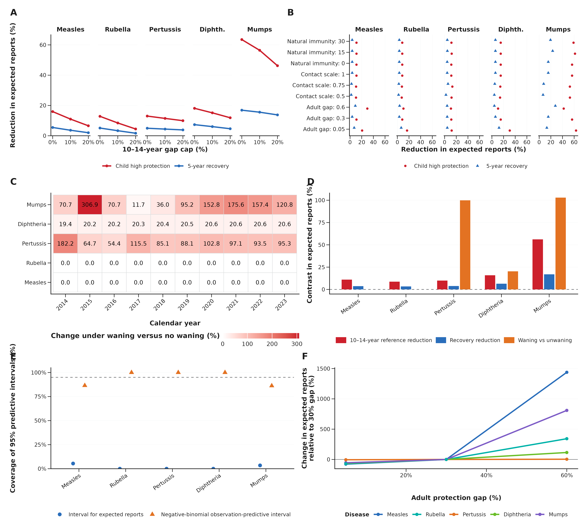

**Supplementary Figure S1 | Paired child-history sensitivity and predictive checks.** (A) Expected-report reductions from the child high-protection cap and five-year recovery across cap levels; the dashed horizontal line marks zero reduction. (B) Paired reductions under adult-gap, immunity-duration, contact-scale and other fixed-input settings, with both histories evaluated on the same posterior draws. (C) Annual waning-versus-no-waning contrasts by disease and year. (D) Pooled waning, 10–14-year high-protection reference and recovery contrasts over 2014–2023; the dashed horizontal line marks zero difference. (E) Held-out 2020–2023 coverage of expected-report and negative-binomial observation intervals; the dashed line marks nominal 95% coverage. (F) Adult-gap sensitivity. All panels use the ten-country daily model; reductions and contrasts are conditional scenario comparisons.

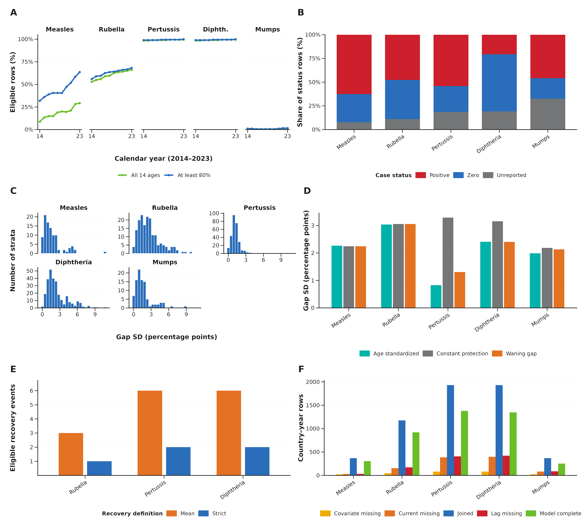

**Supplementary Figure S2 | Reconstruction and observation robustness.** (A) Fraction of all country–years satisfying the complete fourteen-age or at-least-80% reconstruction criteria, by year, using strict component evidence; mumps here uses the strict component layer described in the vaccine mapping in Methods. (B) Composition of case-status rows over 2014–2023; explicit reported zeros and unreported fields remain separate. (C) Distribution of within-stratum gap standard deviations for exact disease × year × current-coverage strata with at least two countries; each histogram counts strata, with disease-specific vertical scales. (D) Residual standard deviations for the waning, constant-protection and equal-age-standardized gap on the same exact-matched sample. (E) Eligible recovery-event counts under mean-based (orange) and strict (blue) recovery definitions. Both require current and following-year coverage ≥90% and previous-year coverage <90%; the preceding three-year mean must be ≤85% for the mean-based definition, whereas each preceding year must be ≤85% for the strict definition. Sparse recovery contrasts are omitted from the publication figure and retained only in the analysis archive. (F) Joined, missing-input and complete model-row counts. Missing-input categories can overlap and are not a sequential attrition decomposition. Panels C–F use the main mumps mapping described in Methods where applicable. Recovery contrasts are descriptive summaries of the reconstruction.

**Supplementary Figure S3 | Bayesian diagnostics and input audit.** (A) Rank-normalized R-hat and (B) standard bulk and tail effective sample sizes for log R0 and log negative-binomial size. Vaccine, reporting and importation inputs remain fixed at declared centres. (C) Fraction of observations inside 95% negative-binomial predictive intervals across 2014–2023, and (D) the same coverage for the held-out 2020–2023 period after calibration through 2019. (E) Positive, reported-zero and unobserved country–year case counts. Indonesia and Pakistan have no observed mumps series, so their responses use the shared disease posterior without country-specific calibration. (F) Contact-matrix spectral radius after reciprocity correction versus maximum reciprocity error across WPP-year age distributions. The posterior intervals do not include uncertainty in fixed nuisance inputs. These diagnostics describe the selected posterior basin; held-out mean prediction is evaluated separately in the predictive-interval panels.

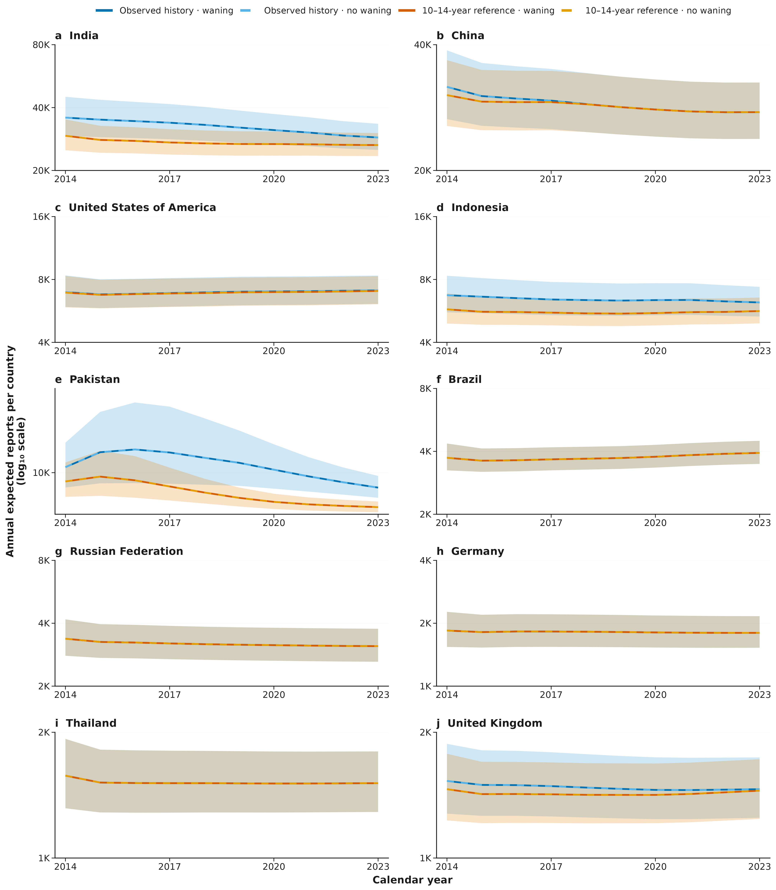

**Supplementary Figure S4 | Country-specific measles history and waning trajectories.** Each facet shows one of the ten selected countries over 2014–2023. Lines show posterior mean annual expected reports for observed history with and without waning and the 10–14-year high-protection reference (gap capped at 0.10 at ages 10–14) with and without waning; ribbons show central 95% posterior intervals. Scenario colours match Fig. 4a, and each country has its own log-scaled y axis. Intervals describe expected reports conditional on the sampled disease parameters and exclude observation noise and uncertainty in fixed nuisance inputs. All trajectories are conditional on the sampled disease parameters and fixed inputs.

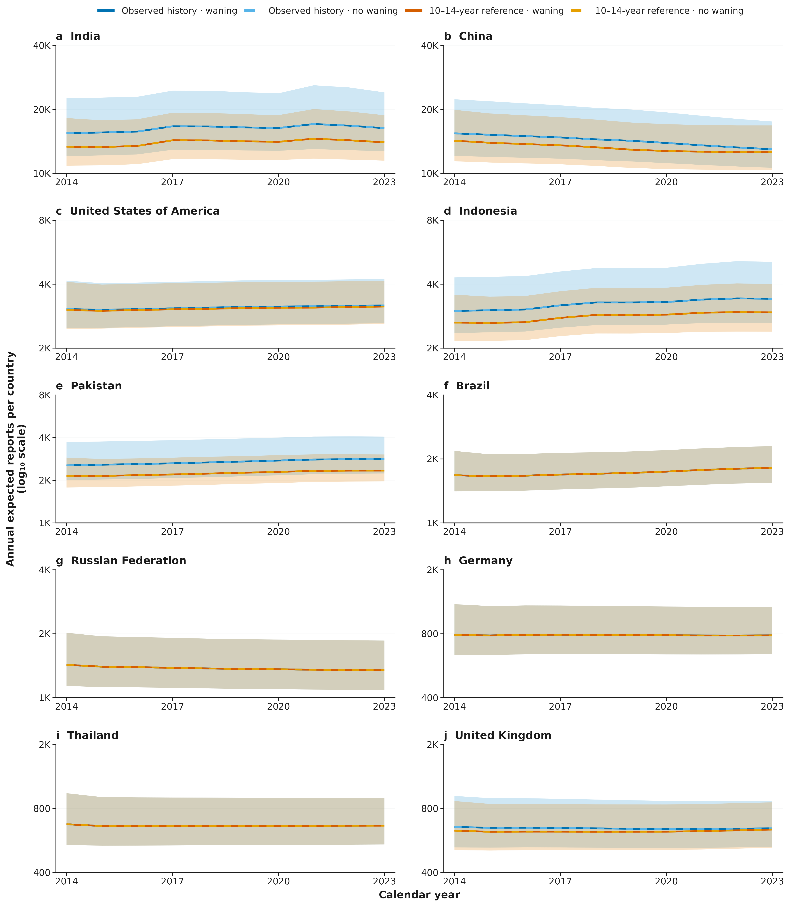

**Supplementary Figure S5 | Country-specific rubella history and waning trajectories.** Each facet shows one of the ten selected countries over 2014–2023. Lines show posterior mean annual expected reports for observed history with and without waning and the 10–14-year high-protection reference (gap capped at 0.10 at ages 10–14) with and without waning; ribbons show central 95% posterior intervals. Scenario colours match Fig. 4a, and each country has its own log-scaled y axis. Intervals describe expected reports conditional on the sampled disease parameters and exclude observation noise and uncertainty in fixed nuisance inputs. All trajectories are conditional on the sampled disease parameters and fixed inputs.

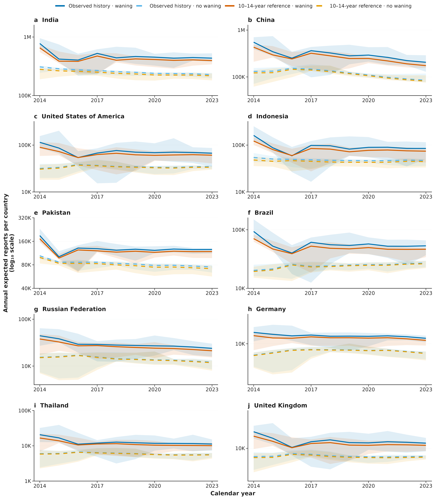

**Supplementary Figure S6 | Country-specific pertussis history and waning trajectories.** Each facet shows one of the ten selected countries over 2014–2023. Lines show posterior mean annual expected reports for observed history with and without waning and the 10–14-year high-protection reference (gap capped at 0.10 at ages 10–14) with and without waning; ribbons show central 95% posterior intervals. Scenario colours match Fig. 4a, and each country has its own log-scaled y axis. Intervals describe expected reports conditional on the sampled disease parameters and exclude observation noise and uncertainty in fixed nuisance inputs. All trajectories are conditional on the sampled disease parameters and fixed inputs.

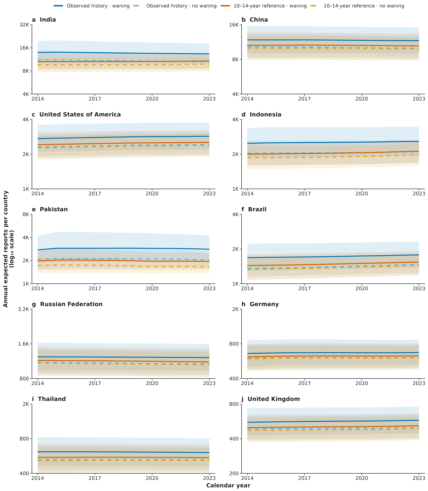

**Supplementary Figure S7 | Country-specific diphtheria history and waning trajectories.** Each facet shows one of the ten selected countries over 2014–2023. Lines show posterior mean annual expected reports for observed history with and without waning and the 10–14-year high-protection reference (gap capped at 0.10 at ages 10–14) with and without waning; ribbons show central 95% posterior intervals. Scenario colours match Fig. 4a, and each country has its own log-scaled y axis. Intervals describe expected reports conditional on the sampled disease parameters and exclude observation noise and uncertainty in fixed nuisance inputs. All trajectories are conditional on the sampled disease parameters and fixed inputs.

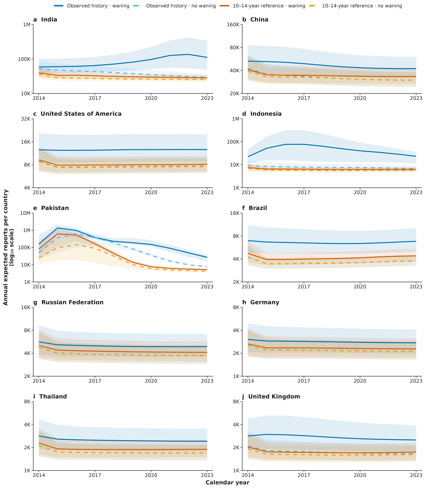

**Supplementary Figure S8 | Country-specific mumps history and waning trajectories.** Each facet shows one of the ten selected countries over 2014–2023. Lines show posterior mean annual expected reports for observed history with and without waning and the 10–14-year high-protection reference (gap capped at 0.10 at ages 10–14) with and without waning; ribbons show central 95% posterior intervals. Scenario colours match Fig. 4a, and each country has its own log-scaled y axis. Intervals describe expected reports conditional on the sampled disease parameters and exclude observation noise and uncertainty in fixed nuisance inputs. Indonesia and Pakistan have no observed mumps series; their trajectories use the shared disease posterior without country-specific calibration. All trajectories are conditional on the sampled disease parameters and fixed inputs.

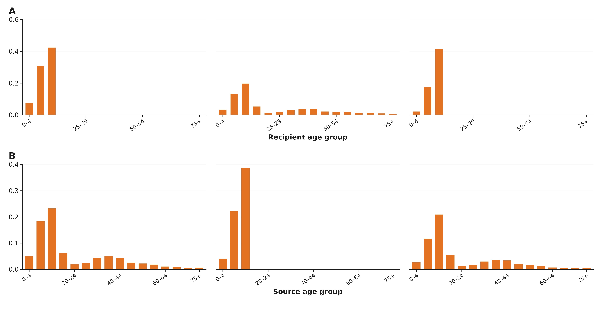

**Supplementary Figure S9 | Marginal gains in the contact-weighted susceptibility operator.** (A) Recipient-age and (B) source-age sums of the waning-minus-no-waning operator differences shown in Fig. 5d. Both sums are calculated from the full sixteen-band operator. Both panels retain all sixteen age bands, matching the full operator in Fig. 5d. Diphtheria has zero acquisition blocking but a nonzero source effect, so adult recipient gains can occur. Columns show pertussis, diphtheria and mumps. Weights use the same common normalization as Fig. 5d. These deterministic structural decompositions are not fitted transmission matrices or uncertainty estimates.

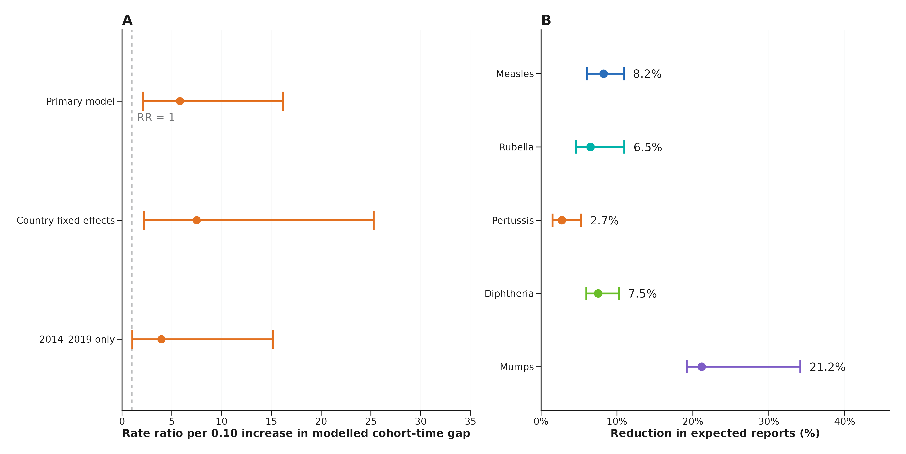

**Supplementary Figure S10 | Robustness of the pertussis association and a one-time catch-up counterfactual.** (A) Pertussis rate ratios per 0.10 absolute increase in the cohort-time gap for the primary model, a model with country fixed effects and a model restricted to 2014–2019; bars show 95% confidence intervals and the dashed line marks a rate ratio of 1. The global likelihood-ratio test comparing a three-degree-of-freedom natural spline with the linear gap gave P = 0.0003. (B) Pooled reductions in 2014–2023 expected reports after a one-time 2018 campaign that lowered the reconstructed gap of the 10–14-year cohort to 0.10; points show pooled reductions and bars the 2.5th–97.5th percentiles across 120 posterior draws. Values are given in Supplementary Tables S11 and S30. The catch-up contrasts are conditional model scenarios, not estimated intervention effects.

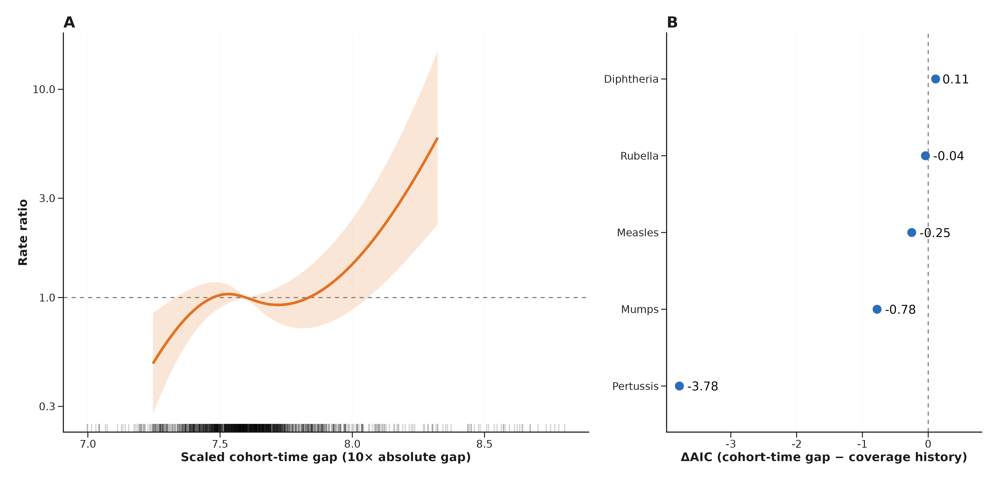

**Supplementary Figure S11 | Nonlinear pertussis association and pre-pandemic model comparison.** (A) Fitted rate ratio from the natural-spline pertussis model relative to the median scaled cohort-time gap, with other covariates at their medians and country random intercepts set to zero; the ribbon shows a pointwise 95% fixed-effect confidence interval for the contrast with the median reference, accounting for their covariance, and the rug shows the observed gaps. The curve spans the 2.5th–97.5th percentiles of the observed gap. (B) ΔAIC = AIC(cohort-time-gap model) − AIC(coverage-history model) for each disease using identical 2014–2019 rows; negative values favour the cohort-time gap. Values are given in Supplementary Tables S11 and S12. The displayed contrasts are ecological associations between the cohort index and reported disease.

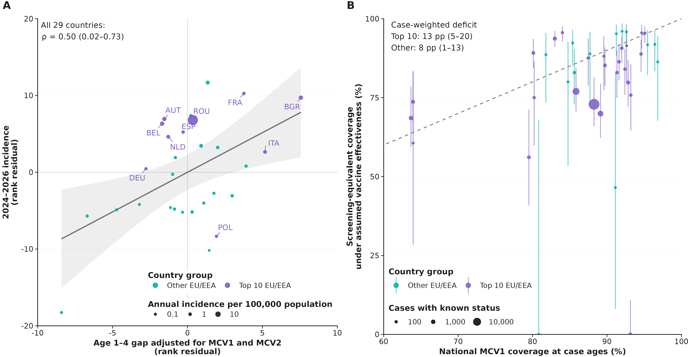

**Supplementary Figure S12 | Country ranking and screening-equivalent coverage for the measles extension.** (A) Added-variable view of the 1–4-year gap in Fig. 3f across 29 EU/EEA countries: the ranks of the 2023 gap and of mean annual 2024–2026 incidence are both residualised on the ranks of 2023 WUENIC MCV1 and MCV2. The annotated partial correlation and its 95% country-bootstrap interval are those shown in Fig. 3f; the line and band are a least-squares fit with its 95% confidence band, shown for orientation. Purple, labelled points are the ten leading countries and teal points the remaining countries; size is annual incidence per 100,000. Because the ten leading countries were selected on reported cases, no separate fit is shown within either group. (B) Screening-equivalent coverage under assumed vaccine effectiveness (0.93–0.97), implied by the vaccinated share of cases, against national MCV1 coverage of the same ages; the dashed line is equality, bars are 95% intervals and size is cases with known status. Annotated deficits are case-weighted means for the ten leading and the remaining countries. These quantities are model-based ecological summaries of cohort–case alignment.

